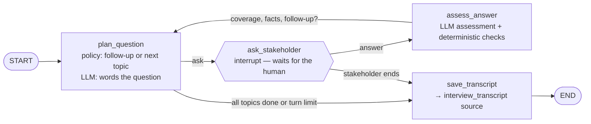

# Adaptive requirement-gathering interviews (step 7)

> **Step 7 of the problem statement.** "The interaction agent should conduct adaptive interviews rather than use a
> fixed questionnaire. It should ask questions about: business objectives; users and roles; existing workflow; inputs,
> outputs and business rules; exceptional conditions; data collection and retention; authentication and
> authorisation; financial transaction limits; audit and reporting requirements; performance and availability;
> integration with existing systems; regulatory and security constraints; expected project schedule and budget. The
> agent should ask follow-up questions when an answer is incomplete, vague or inconsistent."

This guide explains the architecture of the **stakeholder-interaction agent**: what it asks, how it decides what to
ask next, how it judges each answer, and how the result feeds the analysis graph.

| Piece | File |
|---|---|
| The 13 topics, their checklists and which roles are asked | `app/catalog/data/interview_topics.yaml` |
| Per-role interview plan | `app/catalog/loader.py::interview_plan` |
| Deterministic policy: answer checks, coverage, follow-up decision | `app/agents/interview_policy.py` |
| Graph nodes: plan, ask, assess, save | `app/agents/interviewer.py` |
| Graph wiring | `app/graph/builder.py::build_interview_graph` |
| API | `app/api/main.py` (`/interview-sessions`, `/interview-plan`) |
| UI | `frontend/src/components/AiInterview.tsx` |
| Tests | `tests/test_interview.py` |

## 1. Adaptive, not a fixed questionnaire

The system still offers the **fixed questionnaire** (Sources › Interview › *Template*), which serves as a baseline. The AI
interview differs from it in seven ways:

| Fixed questionnaire | Adaptive interview |
|---|---|
| The same list of questions for everyone in a role | Only the topics relevant to the role, primary topics first |
| A fixed order | The LLM picks the next topic from the allowed set, the one that follows most naturally from the last answer |
| Every question is asked | Points already answered **in passing** under another topic are not asked again |
| Answers are accepted as given | Every answer is **assessed**; incomplete, vague, inconsistent or off-topic answers get a **targeted follow-up** |
| Generic wording | Questions are worded from the role's template and domain questions, and refer back to what the stakeholder said |
| No idea what's missing | A live **checklist** of points per topic; gaps become **open questions**, routed to the role who would know |
| Contradictions go unnoticed until analysis | Contradictions with earlier answers are raised **during** the interview, and recorded if they stay unresolved |

## 2. The 13 topics as checklists

Each topic in `interview_topics.yaml` is a **checklist of points** (called *slots*), not a script. A complete answer
on "Financial transaction limits", for example, must give:

- limit types and amounts with currency \*
- per-transaction, daily or monthly basis
- what happens above a limit and who approves overrides
- who sets and changes limits

Points marked \* are **quantified**: they need a number, amount, period, date or named standard. A topic is
*covered* when every point is answered.

Each topic also says:

- **which roles are asked** (primary or secondary);
- **which requirement categories it feeds**, which are used to pull role-specific wording from the role templates (step 2);
- **an opening question**, used only as a fallback.

The full topic × role matrix and every checklist are generated into
[requirement_role_mapping.md §7](requirement_role_mapping.md#7-adaptive-interview-topics--roles).

| Topic | Primary interviewees |
|---|---|
| Business objectives | Product owner, business analyst |
| Users and roles | Product owner, business analyst, customer |
| Existing workflow | Business analyst, operations, customer |
| Inputs, outputs and business rules | Business analyst |
| Exceptional conditions | Business analyst, operations |
| Data collection and retention | Compliance & legal, business analyst |
| Authentication and authorisation | Information security |
| Financial transaction limits | Risk management |
| Audit and reporting | Auditor/regulator, compliance & legal |
| Performance and availability | Architect/developer, operations |
| Integration with existing systems | Architect/developer |
| Regulatory and security constraints | Compliance & legal, information security |
| Expected schedule and budget | Product owner |

The catalog check (`validate_references`) guarantees that:

- every requirement category is fed by at least one topic;
- every topic has a primary role;
- every role is the primary interviewee for at least one topic.

A customer is never asked about budget, and a product owner is never asked about session timeouts.

**Per-role plan.** `interview_plan(role, domain)` returns the role's topics, primary ones first. Each topic comes with
up to four **suggested questions**: the role-template questions for the categories the topic feeds, plus the domain's
key questions for that role. For example, a risk manager on a loan project gets "What eligibility, affordability and
credit-score thresholds decide approval…" under *Business objectives*.

## 3. The interview graph

The interview is a separate LangGraph `StateGraph` (`InterviewState`), with the following properties:

- **Checkpointed** in Postgres under thread `interview-{session_id}`, so an interview can be paused and resumed across
  requests and server restarts.
- **One question per HTTP round trip.** `ask_stakeholder` calls `interrupt()` with the question and the topic, the
  follow-up kind and the points still needed. `POST …/reply` resumes the graph with `Command(resume={answer, finish})`.
- **The LLM and the policy are split.** The LLM is good at language: understanding an answer, extracting facts and
  wording a question. The decisions are made in plain Python (`interview_policy.py`) so they are predictable,
  testable and auditable: when to probe, when to give up on a point, when to move on, when to stop. The LLM can only
  choose among topics the policy allows; any other choice falls back to the first allowed topic.

### State

| Field | Content |
|---|---|
| `transcript` | Each turn: topic, question, answer (masked), whether it was a follow-up and why, the assessment |
| `coverage` | Per topic: status (`pending`, `in_progress`, `covered`, `partial`, `skipped`), answered points, points answered in passing, follow-ups used |
| `facts` | Short facts stated so far (`turn: fact`), the memory used to catch inconsistent answers |
| `pending_follow_up` | The problem with the last answer that the next question must resolve |
| `open_questions` | Points left unanswered, with the reason and the role who would know |
| `contradictions` | Conflicts with earlier answers, marked resolved when the follow-up settles them |

## 4. Assessing each answer (`assess_answer`)

The LLM returns an `AnswerAssessment` for every non-empty answer. It sees:

- the topic's checklist, with the quantified points marked;
- the open points of *other* topics;
- the facts stated so far;
- the answer, wrapped in `<answer>` tags and treated as untrusted data by the shared guardrail.

| Field | Meaning |
|---|---|
| `quality` | `complete`, `incomplete`, `vague`, `inconsistent`, `unknown` ("don't know", "not my area"), `off_topic` |
| `slots_answered` | Points of this topic answered specifically |
| `other_slots` | Points of other topics the answer also settles (`topic.slot`) |
| `vague_phrases` | Unmeasurable words used where a figure is needed |
| `contradiction`, `contradicts_turn` | What it conflicts with, and where |
| `facts` | Up to six short facts, added to the interview's memory |
| `refer_to_role` | Who would know, when the stakeholder doesn't |

**Deterministic checks override the LLM** (`evaluate_answer`):

1. **No figure, no credit.** A quantified point only counts if the answer contains a quantity: a digit, a number word,
   *lakh* or *crore*, a month, or *daily*, *monthly* and similar. If the LLM credits "response time" for "it should be
   fast", the credit is removed and the answer becomes **vague**.
2. **Vague-word lexicon.** Words such as *fast, secure, user-friendly, scalable, as needed, soon, adequate, industry
   standard* make an answer **vague** when a quantified point is still open and the answer has no figure.
3. **"Don't know" detection.** "Not sure", "TBD", "ask the risk team" and similar phrases make an answer **unknown**,
   unless it also answered something.
4. **Complete means complete.** An answer the LLM calls *complete* is downgraded to *incomplete* while points of the
   topic are still open.
5. **Points in passing.** Valid `other_slots` are credited to their topics (under the same no-figure rule). A topic
   whose points are all answered this way is marked covered and never asked.

## 5. Deciding the follow-up

| Answer | What happens next |
|---|---|
| **Inconsistent** | Follow-up that points out the conflict neutrally and asks which is correct, or when each applies. The contradiction is recorded and marked *resolved* if the follow-up answer no longer conflicts |
| **Vague** | Follow-up asking for the specific value in place of the vague words ("You said *fast*: within how many seconds, at what volume?") |
| **Off topic** | Follow-up that steers back to the topic's open points |
| **Incomplete** | Follow-up asking only for the missing points |
| **Unknown** | **No** probing (pressing someone who doesn't know produces guesses). The open points become open questions routed to `refer_to_role` |
| **Empty** (*Skip topic*) | The topic is marked skipped; its points become open questions |
| **Complete** | The topic is covered; on to the next topic |

When an answer has several problems, they are handled in priority order: inconsistent, vague, off-topic, incomplete.
Each topic gets at most `INTERVIEW_MAX_FOLLOW_UPS` (default 2) follow-ups. After that the topic is marked *partial*
and its missing points become open questions, so a stakeholder is never stuck on one topic.

**Choosing the next topic.** If there's no follow-up, `next_topics()` offers up to four topics that haven't started.
Primary topics are offered first, then secondary ones. The LLM picks the one that best follows the last answer and
writes an opening question for **only the missing points**. It is told which facts are already known, so it can
build on them ("You mentioned 20,000 customers a month — at peak, how many apply in an hour?").

**Stopping.** The interview ends when:

- no topic is pending or in progress;
- `INTERVIEW_MAX_TURNS` (default 30) is reached; or
- the stakeholder clicks *Finish*.

## 6. Example

A customer interview on a KYC-onboarding project (taken from `tests/test_interview.py`):

| Turn | Question (topic) | Answer | Assessment → next step |
|---|---|---|---|
| 1 | Users and roles | "Salaried customers and students, mostly on mobile. It should be fast." | LLM said *complete*, but the user-volume point has no figure, so it's **vague** ("fast"). The workflow's *tools* point (mobile) is credited in passing → **follow-up: vague** |
| 2 | Follow-up | "About 20000 customers a month; they open an account and do video KYC" | Complete → *Users and roles* covered → next topic |
| 3 | Existing workflow (doesn't ask about tools again) | "Branch visit with photocopies; it takes 5 days" | Handoffs missing → **follow-up: incomplete** |
| 4 | Follow-up | "Operations approve within 2 days" | Conflicts with turn 3 → **follow-up: inconsistent** |
| 5 | Follow-up | "5 days end to end; 2 days is the operations step" | Contradiction **resolved**; topic covered |
| 6 | Business objectives | *(skipped)* | Topic skipped; its points become open questions |
| 7 | Inputs, outputs and rules | "Not sure, ask the business analyst" | **Unknown**: no probing; open questions routed to the business analyst |

## 7. Output, and how it feeds the analysis graph

`save_transcript` stores an **`interview_transcript` source** attributed to the stakeholder's role, through the normal
ingestion path (masking, sensitivity classification, injection screening, hashing). The text contains:

- every answered turn, labelled with its topic and follow-up kind;
- **topic coverage** (covered, partly covered, skipped or not reached);
- **open points** this stakeholder couldn't settle, with "Refer to: \<role\>";
- **unresolved inconsistencies** (turn vs turn, with the explanation).

The analysis graph then treats the transcript like any other source:

- **extraction** turns answers into requirements with verbatim quotes;
- the open points and unresolved inconsistencies give the **clarification** and **conflict-detection** agents leads,
  already routed to the right role;
- the audit log records `interview_started` and `interview_completed`, with turns, follow-ups, a coverage summary,
  and counts of open questions and contradictions.

Inconsistencies **within** one interview are caught live by this agent. Inconsistencies **between** stakeholders
(e.g. the risk manager's limit vs the product owner's) are caught later by the conflict-detection agent across all
sources.

## 8. Safety and privacy

- Answers are **masked** (Presidio with custom Indian PII recognisers) in the API **before** they enter the graph, so
  the LLM, the checkpoints and the transcript never see raw PII.
- The question prompt forbids asking for personal data (names, account, card or ID numbers).
- The answer is placed inside `<answer>` tags, and the shared guardrail tells the model that tagged content is data,
  not instructions. The saved transcript also goes through injection screening at ingestion.
- Loops are bounded twice: by follow-ups per topic and by turns per interview.

## 9. UI

**Project › Sources › Interview › AI interview:**

- **Chat**: each question shows its topic and, for follow-ups, why it was asked ("Follow-up: answer was vague"). Each
  answer shows its assessment and any unmeasurable words. The current question lists the points still needed.
- **Topic checklist** (side panel, stacks under the chat on narrow screens): every topic for the role, with a status
  mark and label, the number of follow-ups, and the checklist points (✓ answered, "in passing" where relevant).
- **Skip topic** and **Finish interview** buttons.
- **Summary** on completion: the share of checklist points answered, primary topics covered, open points (with whom to
  ask) and unresolved inconsistencies.

## 10. API

| Method | Path | Purpose |
|---|---|---|
| GET | `/catalog` | Includes `interview_topics` |
| GET | `/catalog/roles/{role}/interview-plan?domain=` | The role's topics, priorities, checklists and suggested questions |
| POST | `/projects/{id}/interview-sessions` | Start `{stakeholder_role}`; returns the first question |
| POST | `/projects/{id}/interview-sessions/{sid}/reply` | `{answer, finish}`; an empty answer skips the topic |
| GET | `/projects/{id}/interview-sessions/{sid}` | Session status |

A session response contains the following fields:

- `question`: topic, follow-up kind, reason and the points still needed;
- `transcript`: with an assessment for each turn;
- `topics`: status and checklist for each topic;
- `summary`: coverage;
- `open_questions`;
- `contradictions`;
- `source_id`: once the interview is saved.

## 11. Tests (`tests/test_interview.py`)

- **Catalog:** exactly 13 topics; a valid cross-reference; role plans (risk management starts with transaction limits;
  customers are never asked about budget); domain questions reused as suggestions.
- **Policy:** the vagueness, quantity and "don't know" detectors; the follow-up budget running out → *partial* plus open
  questions; coverage never mutated in place.
- **The full API flow:** the seven-turn example in §6, which covers:
  - masking of an email in the answer;
  - a point credited in passing and not asked again;
  - a contradiction raised and then resolved;
  - a "don't know" answer routed to another role;
  - the saved transcript's coverage and open points;
  - the audit counts;
  - 409 after completion and 404 for a session from another project.

## 12. Configuration

| Setting | Default | Meaning |
|---|---|---|
| `INTERVIEW_MAX_TURNS` | `30` | Hard cap on questions per interview |
| `INTERVIEW_MAX_FOLLOW_UPS` | `2` | Follow-ups per topic before its gaps become open questions |

To change what is asked, edit `interview_topics.yaml` (topics, points, which roles) and regenerate the mapping guide
with `python -m app.catalog.render_guide`. The catalog check will flag any topic, role or category left uncovered.
