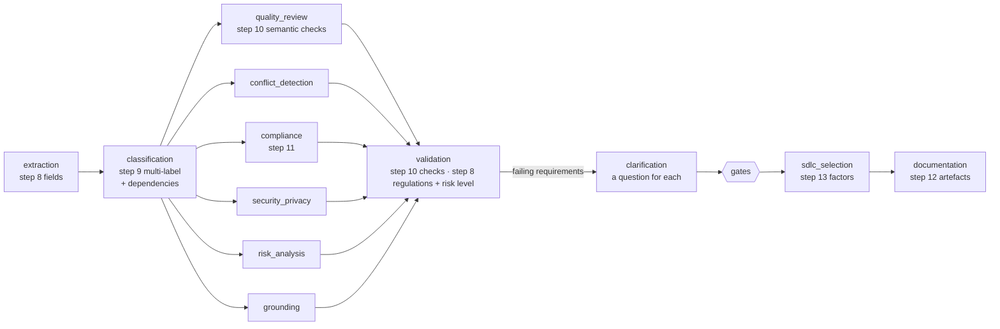

# Agent standards (steps 8–13)

This guide covers steps 8–13 of the problem statement: what every analysis agent must produce, and how each standard
is enforced.

| Step | Standard | Enforced in |
|---|---|---|
| 8 | Every requirement has the same 13 fields | extraction, classification, validation, documentation |
| 9 | Multi-label classification into the 13 categories | classification |
| 10 | Ten quality checks; failing requirements go back to the clarification agent | quality review, conflict detection, security & privacy, compliance, validation, clarification |
| 11 | Compliance determines six things and never makes the final legal call | compliance, human approval |
| 12 | Eleven artefacts, each linked to its stakeholder statement and document | documentation |
| 13 | Thirteen SDLC decision factors feed the recommendation | SDLC selection |

The lists themselves are defined once, in `app/agents/standards.py`:

- `REQUIREMENT_FIELDS`
- `QUALITY_CHECKS`
- `COMPLIANCE_DETERMINATIONS`
- `ARTEFACTS`
- `SDLC_FACTORS`

The agents, the API, the tests and the UI all use these definitions. A standard can't quietly drift: if an agent
stops producing an item, `tests/test_flow.py` fails.

## How a standard is enforced

No standard relies on the LLM alone. Each is held in place by up to four layers:

1. **Prompt.** The agent's prompt says what to produce and what it means.
2. **Schema.** A Pydantic model (`app/schemas.py`) forces the LLM's output into the required fields, with
   `with_structured_output`.
3. **Deterministic guards.** Plain Python then checks or overrides what the LLM said. For example, it:
   - drops IDs the LLM invented;
   - verifies that quotes really appear in the source;
   - never leaves a requirement without a category;
   - forces legal review on high-impact mappings;
   - measures factors instead of letting the LLM guess them.
4. **Tests.** Tests run the whole graph with a stub LLM and assert every item.
   - `tests/test_flow.py`: the full graph;
   - `tests/test_standards.py`: the deterministic parts.



---

## Step 8. The standard requirement structure

> "Convert stakeholder input into a standard requirement structure."

Every requirement passes through several agents, and each fills in the fields it is best placed to know. The finished
record is `standards.standard_record()`. It is returned by `GET /projects/{id}/requirements`, saved in the
`requirements` table, and published as the **Requirements** artefact.

| Field | Filled by | How |
|---|---|---|
| Requirement ID | Coordinator (`consolidate`) | Deterministic numbering per domain and type: `FR-LOAN-001`, `NFR-KYC-003`. Agent suggestions are `SUG-SEC-…` and `SUG-CMP-…` |
| Requirement statement | Extraction | One atomic "The system shall …" statement per requirement; compound statements are split |
| Requirement category | Extraction, then Classification | Multi-label; see step 9 |
| Source stakeholder | Coordinator | The role attached to the source (`stakeholder_role`), or the agent that suggested it (`origin`) |
| Business justification | Extraction | The value, obligation or risk the source gives; left empty rather than invented. Validation flags an empty one (incompleteness) |
| Priority | Extraction, then Classification | MoSCoW, normalised across sources |
| Dependencies | Extraction + Classification | External ones (systems, teams, data, decisions) from extraction. Requirement-to-requirement links (`depends_on`) from classification, the only agent that sees the whole set; unknown IDs are dropped |
| Assumptions | Extraction | Anything the source doesn't confirm |
| Acceptance criteria | Extraction (stories add Given/When/Then) | Required; validation flags requirements without them |
| Applicable regulations | Validation, from Compliance | The regulations of the compliance mappings for that requirement |
| Risk level | Validation, from Risk analysis and Security & privacy | The highest level among linked risks (L × I ≥ 15 is high, ≥ 8 medium) and linked security findings; *low* if none |
| Confidence score | Extraction, then Grounding | The extraction confidence, combined with grounding evidence (step 6) |
| Approval status | Human approval | `proposed` → `accepted` / `modified` / `rejected`; `suggested` for agent proposals until accepted |

**Example**, as produced by the tests:

```
FR-LOAN-001  The system shall require step-up authentication for loans above the approved threshold.
  categories: functional, security · stakeholder: customer · priority: must · risk: high · confidence: 0.62
  justification: Prevent fraud on large loans
  dependencies: Approved risk threshold from risk management · assumptions: The threshold applies per application
  status: modified (escalated → decided by the product owner)
```

## Step 9. Classifying the requirements

> "Multi-label classification should be allowed because one requirement may belong to several categories."

- The 13 categories come from `app/catalog/data/categories.yaml`, and the schema accepts only those 13 values
  (`Category` literal).
- **Extraction** labels each requirement from its own source.
- **Classification** sees all requirements together and makes the type, categories and priority consistent across
  sources. It records a one-line rationale for each requirement.
- `categories` is a list, so any number of labels is allowed. The audit log counts the multi-label requirements.
- **Guard:** if the classifier returns no categories, the extractor's categories are kept. A requirement can never end
  up unclassified.

## Step 10. Analysing requirement quality

> "Requirements that fail these checks should be returned to the clarification agent."

Every finding is tagged with one of ten standard checks (`issue.check`).

| Check | Detected by | How |
|---|---|---|
| Ambiguity | Validation (rules) + Quality review (LLM) | A vague-word lexicon ("fast", "secure", "as needed"…) plus semantic review (unclear subject, more than one reading) |
| Incompleteness | Quality review + Validation | Missing actor, trigger, condition, threshold, data or error handling (LLM); empty business justification and mandatory categories missing for the domain (rules) |
| Inconsistency | Conflict detection + Grounding | Contradictions between requirements from the same stakeholder; requirements that **contradict an approved policy or regulation** (step 6) |
| Duplication | Conflict detection | Exact duplicates (rules) and duplicates or overlaps (LLM) |
| Infeasibility | Quality review | Absolute guarantees ("100% uptime", "zero fraud"), unrealistic targets, or things the law does not allow |
| Lack of testability | Validation + Quality review | No acceptance criteria (rules), or criteria that can't be verified (LLM) |
| Missing source | Validation (rules) | No quote; **or the quote can't be found in the source it claims to come from**. The check is word-normalised: exact, paraphrased (≥ 80% of words) or not found |
| Undefined terminology | Validation (rules) | Acronyms and terms not in the approved glossary (knowledge base) |
| Conflicting stakeholder expectations | Conflict detection + Validation | A conflict whose requirements come from **different stakeholder roles** is classed as a stakeholder conflict rather than a plain inconsistency |
| Missing security or compliance controls | Security & privacy + Compliance | Missing controls and weak security requirements; compliance gaps |

**Returning to the clarification agent.** The graph runs validation **before** clarification, so the loop works like
this:

1. Validation collects every requirement with a medium- or high-severity check failure into `returned`, with its
   failed checks and messages.
2. The **clarification agent** receives that list and must ask at least one question per returned requirement,
   routed to the role best placed to answer.
3. If the LLM misses a requirement, a deterministic **fallback question** is generated for its most serious failed
   check. It goes to the stakeholder who gave the requirement, or to the role that owns that check (e.g. infeasibility →
   architect). Nothing is silently dropped.
4. The failures that make a question **blocking** are high-severity *missing source*, *infeasibility*, *inconsistency*
   and *conflicting stakeholder expectations*. Blocking questions pause the graph at the **clarification gate**.
5. The answers become new sources and the analysis re-runs (at most `MAX_CLARIFICATION_ROUNDS`). Non-blocking
   questions go with the baseline for the approvers.
6. Quality scores include `checks` (requirements failing each check) and `requirements_passing`. The UI shows a
   pass/fail grid of the ten checks in the baseline review's **Issues** tab.

## Step 11. Compliance and security analysis

> "The compliance agent should not make final legal determinations. High-impact interpretations must be approved by
> compliance or legal officers."

| Determination | How the compliance agent produces it |
|---|---|
| Applicable jurisdiction and regulation | Per mapping. When the mapping cites a retrieved passage, the jurisdiction comes from **that passage's metadata**, not the model's guess. Retrieval is already filtered to the project's jurisdiction and GLOBAL |
| Required security or privacy control | `required_controls` per mapping; the security & privacy agent adds missing-control findings and suggested requirements |
| Evidence supporting the mapping | A verbatim quote and the knowledge-base ref of a retrieved passage. Refs that weren't retrieved are removed, and the mapping is downgraded to legal review |
| Compliance gaps | Obligations in the evidence that no requirement covers, each with a suggested requirement (`SUG-CMP-…`) |
| Mandatory approval or audit checkpoints | `checkpoints`: name, SDLC stage, approving role, regulation and the requirements involved. The SDLC workflow adds rule-enforced compliance sign-off and audit-trail tests |
| Data-retention and reporting obligations | Mappings of type `data_retention` or `reporting`, with the period, collected in `retention_and_reporting`. These feed the **Data requirements** artefact |

**No final legal determinations:**

- Every mapping is labelled *"Proposed mapping by the compliance agent; not a legal determination."*
- A mapping goes to **legal review** when:
  - it is **high-impact** (penalties, licence action or customer harm if misread);
  - its evidence isn't *strong*;
  - it cites nothing, or cites a passage that wasn't retrieved.
- Any mapping needing legal review makes **compliance & legal a required approver** of the baseline.
- When that officer approves, every reviewed mapping is stamped `legal_approval: {by, at}`, and
  `legal_interpretations_approved` is written to the audit log. The determination is the human's, and it is recorded.

## Step 12. Requirement artefacts

> "Each generated item should remain linked to its original stakeholder statement and supporting document."

| Artefact | Key | Built from |
|---|---|---|
| Software Requirements Specification | `srs_markdown` | All baseline fields, including justification, dependencies, assumptions, regulations and risk, plus data, interface and assumptions sections, SDLC and risks. Uses the in-force SRS template from the knowledge base |
| User stories and acceptance criteria | `user_stories` | LLM, one per functional requirement, with Given/When/Then; unknown IDs dropped |
| Use-case descriptions | `use_cases` | LLM: actor, preconditions, main, alternative and exception flows, postconditions |
| Process workflows | `process_workflows` | **Deterministic** Mermaid flowchart per use case: main steps, alternative branches, exception exits. Rendered on the artefacts page |
| Data requirements | `data_requirements` | Baseline requirements tagged *data* or *privacy*, with their retention obligations, regulations and source sensitivity |
| Interface requirements | `interface_requirements` | Requirements tagged *integration*, with dependencies and acceptance criteria |
| Threat and risk register | `threat_risk_register` | Risks (L × I) and **threats** from security & privacy findings, with the control requirement that addresses each, if accepted |
| Compliance-control matrix | `compliance_matrix` | Mappings (jurisdiction, controls, evidence, impact, legal approval), gaps and whether they are closed, checkpoints, retention and reporting |
| Requirements Traceability Matrix | `traceability_matrix` | Requirement → stakeholder → source (title, id, SHA-256) and **source quote** → regulations → KB citations → risks → use case → story → SDLC phase → tests → approvers |
| Assumptions and dependency register | `assumptions_dependencies` | `ASM-nn` and `DEP-nn` rows, with dependencies split into internal (on a requirement) and external |
| Open-issues list | `open_issues` | Outstanding clarification questions and high-severity issues |

Two more artefacts sit alongside: `requirements` (the step-8 records) and `sdlc` (decision, factors and signals).

**Links to the original statement.** Every row of every artefact carries a `trace`, or a list of them. A trace holds:

- the requirement ID;
- the stakeholder role;
- the source document's ID and title;
- the **verbatim source quote**;
- any KB citations.

The quote itself was checked against the source text in step 10, and the RTM adds the source document's SHA-256 hash,
so the chain is verifiable: artefact row → requirement → stakeholder statement → document.

## Step 13. SDLC decision factors

> "These factors become inputs to the SDLC recommendation mechanism."

All thirteen factors are scored from 1 to 5 and feed the TOPSIS ranking and the decision-table rules
(`sdlc_models.yaml`).

| Factor | How it's derived |
|---|---|
| Requirement stability | LLM, from the baseline and clarification history |
| Regulatory criticality | LLM, given the share of regulatory/audit requirements and legal-review count |
| Security risk | LLM, given the high-risk count and security findings |
| Project complexity | LLM |
| **System size** | **Measured** from the requirement count (≤10 → 1 … >100 → 5), plus 1 if there are 5 or more integration requirements |
| Legacy-system dependence | LLM, given the count of requirements mentioning legacy, core banking, mainframe, batch files… |
| Frequency of expected changes | LLM |
| Need for continuous delivery | LLM |
| **Availability of stakeholders** | **Measured** from the share of the domain's required roles that provided input, minus 1 if blocking questions remain unanswered |
| Testing and documentation requirements | LLM |
| Budget and schedule constraints | LLM, given the requirements and assumptions that mention deadlines, go-live or budget |
| Need for formal verification | LLM |
| Consequences of system failure | LLM (financial loss, regulatory breach, customer harm) |

- `factor_signals()` measures the project facts and gives them to the LLM, which is told not to contradict them.
- `factors.factor_sources` records which factors were measured and which were estimated. The SDLC gate marks measured
  factors.
- Each SDLC model has an ideal value for all thirteen factors, and several rules use the step-13 factors directly
  (rules version 2.0):

| Rule | Condition | Effect |
|---|---|---|
| R1 | Consequence of failure ≥ 4 and system size ≥ 4 | Pure Agile loses points; V-Model and the Agile–V-Model hybrid gain (Boehm & Turner) |
| R7 | Stakeholder availability ≤ 2 | Agile loses 10, DevSecOps loses 5 (Agile Manifesto) |
| R8 | Consequence of failure ≥ 4 and formal verification ≥ 4 | V-Model and the Agile–V-Model hybrid gain points |
| R9 | Legacy dependence ≥ 4 | DevSecOps loses points, V-Model gains (DORA) |
| R11 | Fixed budget/schedule and stable requirements | Waterfall gains points |
| C6, C9, C10, C12 | System size, budget/schedule and failure consequence | Course rules for RAD, Incremental and Spiral |

- The factors are one of the engine's two input groups; the other is the course's SDLC-selection questionnaire. See
  [sdlc_selection_research_and_rules.md](sdlc_selection_research_and_rules.md) for the whole engine.
- Factors missing from an older rules version default to the neutral 3, so existing knowledge-base versions of the
  rules still work.

---

## Standards by agent

| Agent | Steps | Standards it follows |
|---|---|---|
| **Coordinator** | 8 | Assigns requirement IDs and the source stakeholder; keeps the source ID and title on every requirement for traceability |
| **Stakeholder interaction** | 7 → 8 | Saves transcripts as sources, so every answer can be quoted as the source statement |
| **Requirement extraction** | 8, 9 | Produces statement, categories (multi-label), priority, business justification, assumptions, dependencies, acceptance criteria, verbatim quote and confidence; never invents a justification |
| **Classification** | 8, 9 | Makes type, multi-label categories and priority consistent; links requirement-to-requirement dependencies; never leaves a requirement unclassified |
| **Quality review** | 10 | Checks ambiguity, incompleteness, infeasibility and lack of testability, each with a fix |
| **Conflict detection** | 10 | Checks duplication and inconsistency; the validation agent separates conflicts between stakeholders |
| **Compliance** | 10, 11 | Finds missing compliance controls (gaps); produces the six step-11 determinations; proposes only, so high-impact or weakly evidenced mappings go to legal review |
| **Security & privacy** | 10, 11, 12 | Finds missing security and privacy controls; supplies required controls; feeds the threat register |
| **Risk analysis** | 8, 12 | Supplies each requirement's risk level; feeds the threat and risk register |
| **Grounding** | 8, 10 | Supplies the combined confidence score; finds inconsistency with policies and regulations |
| **Validation** | 8, 10 | Completes regulations and risk level; runs the deterministic checks (missing source with quote verification, undefined terms, testability, ambiguity); tags all findings with the ten checks; returns failing requirements |
| **Clarification** | 10 | Asks a question for every returned requirement (with fallbacks) and routes it to the right role; blocking checks pause the graph |
| **Human approval** | 8, 11 | Sets the approval status (accept, modify, reject); makes compliance & legal a required approver and records their approval of high-impact interpretations |
| **SDLC selection** | 13 | Derives all thirteen factors (two measured); feeds them to the rules and TOPSIS |
| **Documentation** | 8, 12 | Persists the step-8 fields; generates the eleven artefacts, each row traced to its stakeholder statement and document |

## Where to see it

**API**

- `GET /projects/{id}/requirements`: step-8 records.
- `GET /projects/{id}/runs` while at the baseline gate:
  - `state.returned`;
  - `state.issues[].check`;
  - `state.quality.checks`;
  - `state.compliance.checkpoints`;
  - `state.compliance.retention_and_reporting`.
- `GET /projects/{id}/artifacts`: all artefacts.

**UI**

- **Baseline review:** each requirement shows its justification, dependencies, assumptions, regulations and a risk
  tag. The **Issues** tab has the ten-check grid and a "returned for clarification" note. The **Clarifications** tab
  lists the questions.
- **SDLC gate:** the factors, with measured ones marked.
- **Documents**, one tab per artefact:
  - Requirements
  - Process workflows (diagrams)
  - Data requirements
  - Interface requirements
  - Threat & risk register
  - Compliance matrix, with checkpoints and retention/reporting
  - Traceability matrix, with source quotes
  - Assumptions & dependencies
  - Open issues, with traces

**Tests**

- `tests/test_flow.py` asserts every standard on a full run with a stub LLM.
- `tests/test_standards.py` covers:
  - the list sizes (13 / 10 / 6 / 11 / 13);
  - quote verification;
  - fallback questions;
  - measured factors;
  - process workflows;
  - the register.
