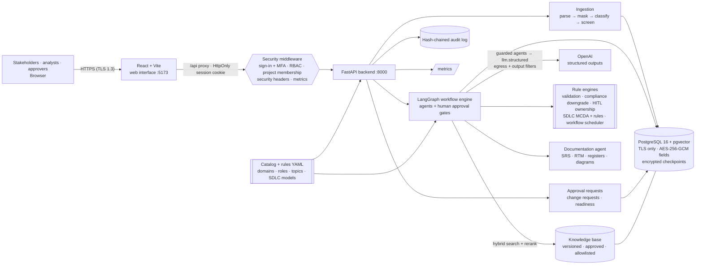
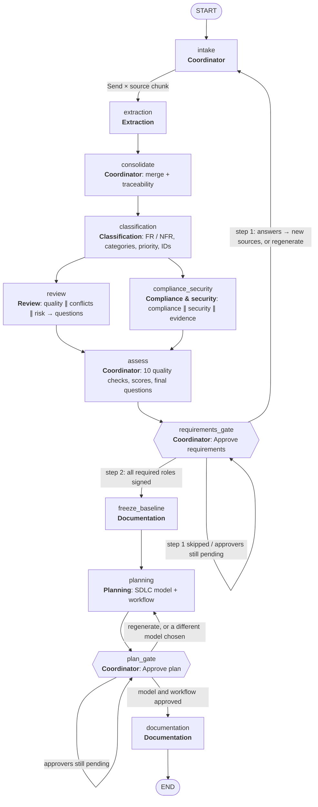
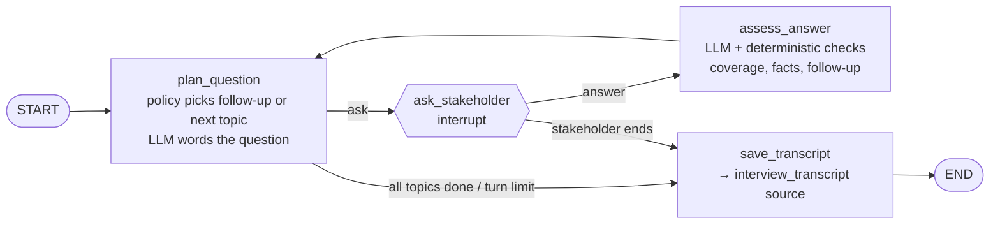
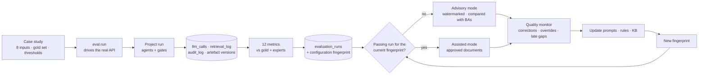

# Architecture

An agentic AI system that gathers requirements for financial-sector software, analyses them, and recommends an SDLC model.
The work is done by specialised agents, coordinated as a LangGraph workflow. A human must approve before anything is baselined.

## 1. High-level view



| Layer | Technology | Responsibility |
|---|---|---|
| Frontend | React 19, TypeScript, Vite, react-router, react-markdown, Mermaid | Sign-in and MFA, projects, sources and interviews, approval gates, documents, governance, knowledge base, administration |
| API | FastAPI (Python 3.12) | REST endpoints, validation, uploads, starting and resuming workflows |
| Security | Custom identity (scrypt, TOTP), RBAC middleware, AES-256-GCM (`cryptography`), Presidio | Authentication, authorisation, encryption, masking, filtering, audit (see [platform_security.md](platform_security.md)) |
| Agent orchestration | LangGraph + LangChain OpenAI | Multi-agent graphs, parallel agents, human-in-the-loop interrupts, encrypted checkpoints |
| LLM | OpenAI (`OPENAI_MODEL`, default `gpt-4.1-mini`) | Language understanding and generation, always as schema-validated structured output |
| Rules | Python + YAML | Deterministic validation, approvals, SDLC scoring and workflow scheduling: reproducible and auditable |
| Storage | PostgreSQL 16 + pgvector (Docker, TLS) | Relational data, vectors, checkpoints, audit log |

### 1.1 Prototype technology stack (step 18)

Step 18 suggests a practical stack of ten components. This is what the prototype uses for each, and what a production
deployment would swap in.

| Suggested component | What the prototype uses | Where | Production option |
|---|---|---|---|
| **LLM for language understanding and generation** | OpenAI `gpt-4.1-mini` through LangChain, with structured (function-calling) output validated by Pydantic. Small routine steps (classification, interview question planning, KB query rewriting) are routed to `gpt-4.1-nano`; every call is metered for tokens and cost. Embeddings: local `BAAI/bge-small-en-v1.5` (384 dimensions, MIT licence, no cost; `text-embedding-3-small` is an option). Reranker: `BAAI/bge-reranker-base` cross-encoder (local CPU) | `app/llm.py`, `app/kb/rerank.py` | Dated model snapshot (`MODEL_PINNING_REQUIRED`); enterprise zero-retention agreement, a regional deployment, or a self-hosted model |
| **Agent orchestration framework** | **LangGraph**: analysis graph (coordinator, extraction fan-out, 6 parallel analysis agents, validation, clarification, SDLC, workflow, documentation) and interview graph; every node wrapped with least-privilege permissions | `app/graph/builder.py`, `app/agents/`, `app/security/agent_permissions.py` | Same; LangGraph Platform or workers for long runs |
| **Vector database for semantic retrieval** | **pgvector** in PostgreSQL: HNSW index (cosine) plus full-text GIN index, combined by reciprocal rank fusion and reranked; works keyword-only until vectors exist | `app/kb/retrieval.py`, `app/models.py` (`kb_chunks`) | Same database at larger scale, or a managed vector store; the retrieval interface stays |
| **Relational database for structured requirements** | **PostgreSQL 16** with SQLAlchemy 2: projects, sources (encrypted), requirements (13 standard fields, versions), artefacts, approvals, users, sessions, audit log, KB | `app/models.py`, `app/db.py` | Managed Postgres with TLS `verify-full`, encryption, backups, Alembic migrations |
| **Rule engine for compliance and SDLC logic** | Declarative YAML rule tables evaluated by small Python engines. SDLC: 10 models, the course's 19-question matrices, 30 sourced rules, TOPSIS + weighted fit. Compliance: evidence-strength and high-impact → legal review. Validation: ten quality checks. HITL: decision ownership. Workflow: mandatory-control placement | `app/catalog/data/sdlc_models.yaml`, `app/rules/`, `app/agents/validation.py`, `app/agents/compliance.py`, `app/hitl/controls.py` | Same rules in the versioned KB (`sdlc-selection-rules`); a BRMS such as Drools if business users must author rules |
| **Workflow engine for approvals** | LangGraph **interrupts** with a Postgres checkpointer for the in-graph gates (clarification, baseline, SDLC, workflow); `approval_requests` with role routing for after-completion decisions (change requests, production readiness) | `app/agents/approval.py`, `app/hitl/` | Same, or integration with the bank's BPM/ticketing (e.g. ServiceNow) for change control |
| **Web interface for stakeholder interaction** | **React** single-page app: adaptive AI interviews, questionnaires, uploads, gate reviews, governance, knowledge base, administration | `frontend/src/` | Same, behind the corporate SSO |
| **Document-generation component** | Documentation agent: SRS in Markdown (with Mermaid Gantt), user stories, use cases, process-flow diagrams, data and interface requirements, threat and risk register, compliance matrix, RTM, assumptions register, open issues; Markdown and JSON download; regeneration after approved changes | `app/agents/documentation.py`, `frontend/src/components/ArtifactsView.tsx` | Add DOCX/PDF rendering (e.g. python-docx or Pandoc) and a DMS export |
| **Identity and access-management system** | Built-in IAM: users and catalog roles, scrypt passwords, TOTP MFA, server-side sessions, deny-by-default RBAC, project membership, admin console | `app/security/auth.py`, `app/security/rbac.py`, `app/api/auth_routes.py`, Administration page | Federate with the bank's IdP (OIDC/SAML), mapping IdP groups to the same roles |
| **Monitoring and audit platform** | Hash-chained audit log with the authenticated principal and a tamper check; Prometheus-format `/metrics`; `/health`; provenance of model, prompt, rules and KB versions per run; every prompt and response (`llm_calls`) and every KB search (`retrieval_log`); quality monitoring of corrections, overrides and late compliance gaps; evaluation harness | `app/audit.py`, `app/security/monitoring.py`, `app/security/provenance.py`, `app/ops.py`, `eval/` | Stream to SIEM (write-once) and Prometheus/Grafana; alerting |

### 1.2 Starting with one financial use case

Step 18 recommends starting with one use case, such as loan processing or digital customer onboarding, before
extending to other services. The prototype does this:

- **Enabled:** `loan_processing` (loan origination and credit assessment) is the primary use case, and
  `kyc_onboarding` (digital customer onboarding) is the second. Their knowledge is seeded: the loan-origination and
  KYC processes, credit, data-retention and access-control policies, and the glossary.
- **Planned but disabled:** the other six domains (digital and mobile banking, payment processing, fraud detection,
  insurance and investment platforms, regulatory reporting, financial data analytics) are in `domains.yaml` with
  `status: planned`. The API refuses to create projects for them, and
  the UI shows them as unavailable.
- **Extending to a new service** is configuration plus knowledge, not code:
  1. seed and approve that domain's processes, policies and regulations in the knowledge base;
  2. review its required roles, mandatory categories and key questions in `domains.yaml`;
  3. switch its `status` to `active`.

## 2. Repository layout

```
Code/
├── app/
│   ├── api/main.py            FastAPI app, projects, sources, runs and gates
│   ├── api/*_routes.py        auth, knowledge base, human-in-the-loop, deploy/monitor (ops) routers
│   ├── ops.py                 step 20: deployment stage, re-evaluation, analyst comparison, quality monitor, accountability pack
│   ├── catalog/
│   │   ├── data/              ← single source of truth for steps 1–3 (YAML)
│   │   │   ├── categories.yaml   13 requirement categories
│   │   │   ├── domains.yaml      8 financial domains (scope, required roles, mandatory categories)
│   │   │   ├── sources.yaml      10 input source types
│   │   │   ├── outputs.yaml      8 expected outputs
│   │   │   ├── roles/*.yaml      9 stakeholder roles and their interview templates
│   │   │   └── interview_topics.yaml  the 13 adaptive-interview topics, checklists and role mapping
│   │   ├── loader.py          typed loading, coverage validation, interview-template builder
│   │   └── render_guide.py    generates guide/requirement_role_mapping.md
│   ├── ingestion/
│   │   ├── parsers.py         PDF, DOCX, EML, JSON/YAML (OpenAPI, questionnaires), CSV, TXT/MD/SQL → text
│   │   └── service.py         parse → mask → classify → screen → store
│   ├── security/              step 17 (see guide/platform_security.md)
│   │   ├── masking.py         Presidio masking (with regex fallback)
│   │   ├── classification.py  sensitivity levels and prompt-injection detection
│   │   ├── filters.py         prompt egress, output filtering, injection neutralisation
│   │   ├── auth.py · rbac.py  identity, TOTP MFA, sessions; deny-by-default RBAC, project membership
│   │   ├── crypto.py          AES-256-GCM fields and checkpoints, key rotation
│   │   ├── agent_permissions.py  least-privilege data and tools per agent
│   │   ├── retention.py · provenance.py · monitoring.py · users.py · devcert.py
│   ├── hitl/                  step 16: decision ownership, change requests, readiness reviews
│   ├── agents/                one module per agent
│   │   ├── coordinator.py     intake, fan-out, consolidation, all routing rules
│   │   ├── extraction.py · classification.py · clarification.py · conflict.py
│   │   ├── compliance.py · security_privacy.py · risk.py · validation.py
│   │   ├── approval.py        human-approval agent (3 gates, approver routing)
│   │   ├── sdlc.py · documentation.py · interviewer.py
│   │   └── common.py          prompt helpers
│   ├── graph/
│   │   ├── state.py           ProjectState / InterviewState (typed shared context)
│   │   └── builder.py         graph topology (the orchestrator)
│   ├── kb/                    knowledge base: collections, chunking, ingest, lifecycle, retrieval, rerank, lookup, seed
│   ├── rules/sdlc.py          deterministic SDLC scoring
│   ├── rules/workflow.py      SDLC-specific workflow scheduler and control placement
│   ├── llm.py                 single LLM entry point (guardrail prompt, structured output, embeddings)
│   ├── models.py              SQLAlchemy tables
│   ├── schemas.py             Pydantic models (LLM outputs and API)
│   ├── audit.py               audit-log writer
│   ├── db.py, config.py
├── frontend/                  React app (src/pages, src/components, src/api.ts)
├── eval/                      step 19: case studies with gold sets, 12 metrics, SDLC expert benchmark, runner, reports
├── guide/                     this document and the topic guides
├── tests/                     unit and end-to-end tests (LLM stubbed)
└── docker-compose.yml         Postgres + pgvector
```

## 3. System scope (problem-statement steps 1–3)

All scope definitions live in `app/catalog/data/*.yaml`. The API (`GET /catalog`), the agent prompts, the validation rules,
the React UI and `guide/requirement_role_mapping.md` are all derived from these files, so they cannot drift apart.
`Catalog.validate_references()` and the unit tests check that the catalog is complete:

- every one of the 13 requirement categories is owned (as primary) by at least one role;
- every role has interview questions for every category assigned to it;
- every domain, source type and domain question refers to a valid role and category.

| Step | How it is implemented |
|---|---|
| **1. System scope** | 8 domains (`domains.yaml`), each with a code (used in requirement IDs such as `FR-LOAN-001`), typical regulations, **required stakeholder roles** and **mandatory requirement categories**. 8 expected outputs (`outputs.yaml`), each marked implemented or planned. |
| **2. Stakeholders** | 9 roles (`roles/*.yaml`), each with primary and secondary requirement categories and a **role-specific interview template**: one section per category, with questions and an example requirement. `GET /catalog/roles/{role}/interview?domain=…` merges in domain-specific questions. Answers are stored as a structured questionnaire source. |
| **3. Input sources** | 10 source types (`sources.yaml`), structured or unstructured, each with accepted formats, a default sensitivity and **extraction guidance** that is injected into the LLM prompt. Text can be pasted or files uploaded. All input is masked and classified before storage (§5). |

## 4. Multi-agent architecture (LangGraph)

There are two graphs, built in `app/graph/builder.py`. Each agent is a module in `app/agents/`. The live diagrams are served at
`GET /graph` and rendered on the UI's **Agent graph** page.

### 4.1 Requirements-analysis graph

Seven agents and two human approval gates. The multi-step agents (review, compliance & security, planning) run each
of their steps through `guard()` under the step's own name, so every step keeps its own narrow data view, write list
and knowledge-base allowlist (`app/security/agent_permissions.py`).



### 4.2 Interview graph (stakeholder-interaction agent)



Step 7 (adaptive requirement-gathering conversations) is explained in [adaptive_interviews.md](adaptive_interviews.md).

The output standards every agent follows (steps 8–13) are explained in [agent_standards.md](agent_standards.md).
The model-specific workflow (step 15) is in [sdlc_workflow_generation.md](sdlc_workflow_generation.md), and every
human-in-the-loop control (step 16) in [human_in_the_loop.md](human_in_the_loop.md).

### 4.3 Agents

| Agent | Node(s) | Kind | Writes to state | What it does |
|---|---|---|---|---|
| **Coordinator** | `intake`, `consolidate`, `assess`, `requirements_gate`, `plan_gate`, all routing functions | Rules + `interrupt()` | `sources`, `requirements`, `issues`, `quality`, `returned`, `clarifications`, approvals | Loads masked sources, splits them into chunks of about 8,000 characters and fans out extraction (`Send`); merges results with traceability; **assess** runs the ten step-10 quality checks (quotes verified against the source text), completes regulations and risk level per requirement, scores quality, turns findings into `SUG-…` requirements and gives every failing requirement a question; runs both human gates (decides who must approve, pauses, applies edits, loops until every required role has signed); makes every routing decision. Never calls the LLM |
| **Extraction** | `extraction` (parallel) | LLM | `extractions` | Atomic, testable requirements in the step-8 structure (justification, assumptions, dependencies, verbatim quote…), guided by the source type and stakeholder role |
| **Classification** | `classification` | LLM + rules | `requirements` | Decides functional vs non-functional, 13-category multi-label tags (never empty) and MoSCoW priority consistently across all sources, with a rationale; links requirement-to-requirement dependencies; numbers requirements `FR-…` / `NFR-…` by their final type |
| **Review** | `review` (steps: `quality_review` ∥ `conflict_detection` ∥ `risk_analysis`, then `clarification`) | Rules + LLM + RAG | `quality_findings`, `conflicts`, `risks`, `clarifications` | Ambiguity, incompleteness, infeasibility and lack of testability with fixes; contradictions, duplicates and overlaps (exact duplicates by rule, hallucinated IDs discarded); a risk register scored likelihood × impact; then questions for each problem and for domain gaps, routed to the right role |
| **Compliance & security** | `compliance_security` (steps: `compliance` ∥ `security_privacy` ∥ `grounding`) | RAG + LLM | `compliance`, `security_findings`, `grounding` | Proposes regulation mappings with jurisdiction, controls, evidence, retention/reporting obligations and checkpoints, and finds gaps (high-impact or weakly evidenced mappings need compliance/legal approval); missing controls and privacy risks with proposed requirements; step 6 grounding per requirement with verified citations, a combined confidence and escalation. See [retrieval_grounded_generation.md](retrieval_grounded_generation.md) |
| **Planning** | `planning` (steps: `sdlc_selection`, then `sdlc_workflow`) | LLM + rules + MCDA | `factors`, `sdlc_recommendations`, `sdlc_explanation`, `sdlc_workflow` | Derives the 13 step-13 factors and answers the course's 19 selection questions; TOPSIS + weighted fit + 30 sourced rules rank 10 models by % suitability (the LLM explains but cannot change the ranking); then tailors the model's phases into a project workflow, with rules adding missing mandatory controls. Once the model is approved, only the workflow is rebuilt |
| **Documentation** | `freeze_baseline`, `documentation` | DB + LLM | `artifacts` | Saves the approved baseline (step-8 fields included) and generates the eleven step-12 artefacts; every row links to its stakeholder statement and supporting document |
| *Stakeholder interaction* | separate interview graph (§4.2) | LLM | transcript → source | Adaptive interview over the 13 step-7 topics relevant to the role. Not part of the analysis flow; its UI tab is currently hidden (`SHOW_INTERVIEWS` in `ProjectPage.tsx`). See [adaptive_interviews.md](adaptive_interviews.md) |

∥ = runs in parallel. `review` and `compliance_security` start together after classification and LangGraph joins them
at `assess`; inside each, the independent steps also run in parallel.

### 4.4 Human approval routing

Both gates are run by the coordinator and each has two steps. The gate payloads keep their names (`clarification`,
`baseline`, `sdlc`, `workflow`), so the API and UI show which step is pending.

| Gate · step | Required approvers | Options |
|---|---|---|
| **Approve requirements · 1 questions** | The stakeholder role each question is routed to (answers are entered by the analyst). Only when there are blocking questions; once per analysis pass | Answer (masked, stored as a questionnaire source for that role, then all agents re-run), skip to sign-off, or regenerate the analysis with feedback. At most `MAX_CLARIFICATION_ROUNDS` (2) rounds |
| **Approve requirements · 2 sign-off** | Product owner (always); compliance & legal if any regulatory requirement or legal-review flag; infosec if any high-severity security finding or high security risk; architect if any must-have integration, performance or availability requirement; plus every role that owns a decision | Approve (with per-requirement accept, reject or modify edits) or request regeneration with feedback. High-risk security, architecture-critical, stakeholder-conflict and escalated requirements must be decided by their owning role; regulatory interpretations by compliance & legal. Suggested `SUG-…` items enter the baseline only if accepted |
| **Approve plan · 1 SDLC model** | `SDLC_APPROVERS` (default: project manager, architect, infosec, compliance & legal, as step 14 requires) | Approve, optionally choosing a different model (justification required; the workflow is then rebuilt for it); request regeneration with feedback; or answer/correct the project-characteristic questions and re-rank |
| **Approve plan · 2 workflow** | `WORKFLOW_APPROVERS` (default: project manager, infosec, compliance & legal) | Approve; modify phases and timeline (mandatory controls are reinstated); request regeneration with feedback |
| **After completion** | Change requests: product owner, project manager + roles by impact. Readiness: project manager, operations, infosec, compliance & legal | Change requests to the approved baseline (impact analysis, new requirement version); production-readiness go / conditional / no-go with attestations and waivers. See [human_in_the_loop.md](human_in_the_loop.md) |

The API rejects approvals from a role that isn't pending (403) and regeneration requests without feedback (422). All free text
(answers, feedback, edited statements, interview replies) is masked **before** it is passed to the graph, so it never reaches checkpoints or the LLM unmasked.

### 4.5 SDLC selection engine (step 14) and workflow (step 15)

The full research, every rule with its source, and the course matrices are in
[sdlc_selection_research_and_rules.md](sdlc_selection_research_and_rules.md). In short:

1. **Inputs.** The 13 step-13 factors (1–5), and the answers to the course's 19 SDLC-selection questions (requirements,
   project team, user community, project type and risk). Answers come from an approver at the gate, else from measured
   data, else from the LLM; unknown answers are left out.
2. **Multi-criteria analysis** over 10 models (Waterfall, V-Model, Prototype, Spiral, RAD, Incremental, Agile, DevSecOps,
   Agile–V-Model and Agile–DevSecOps hybrids). Criteria are the factors (closeness to each model's ideal profile) and the
   four characteristic categories (share of answers matching the model's column in the course matrices). TOPSIS gives
   relative closeness; the weighted fit keeps the score interpretable.
3. **Rules.** 30 rules add or subtract points: PS1–PS6b from the problem statement's table, C1–C12 from the course
   slides, R1–R11 from research (Boehm & Turner, Stacey/Cynefin, Agile Manifesto, DORA, NIST SSDF, PCI DSS, ISO 27001,
   AAMI TIR45, Kuhrmann et al.). Every adjustment is shown with its source.
4. **Ranked % suitability** = 100 × (1 − e^(−raw/50)) of the raw score: same order, no ties at a 100 cap.
5. **Explanation.** The LLM justifies the computed order, explains why the alternatives ranked lower and when to revisit the choice. It cannot reorder.
6. **Approval** by the project manager, architect, security team and compliance officer (step 14).
7. **Workflow.** After approval, the chosen model's canonical phases are tailored with activities, roles, deliverables, security activities, testing, compliance checkpoints, entry and exit criteria, a gate and the requirement IDs delivered. Control rules then add anything missing: threat modelling (security/privacy requirements), SAST, transaction-integrity testing (payments, lending, banking), compliance sign-off before release (regulatory requirements) and audit-trail verification (audit requirements).

### 4.6 Knowledge base (steps 5–6)

Eight versioned, authorised collections (regulations, policies, security standards, glossary and processes, RE guidelines,
SDLC rules, templates, approved project history) with mandatory source / jurisdiction / effective date / version /
applicability. Structure-aware parent–child chunking with context headers; HNSW vector index + full-text GIN index;
hybrid search fused with Reciprocal Rank Fusion, cross-encoder reranking, parent expansion and evidence-strength
scoring; per-agent collection allowlists; draft → approve → supersede lifecycle with section diffs, as-of retrieval and
regulatory-change impact flags. Full description: **[guide/knowledge_base.md](knowledge_base.md)**.

### 4.7 Design choices

- **The coordinator owns all routing, as rules.** No LLM decides which agent runs next, so runs are reproducible and auditable.
- **Specialists run in parallel and write to separate state keys.** There are no write conflicts. Validation is the single place where findings are merged.
- **Every LLM call goes through `llm.structured()`.** It applies one guardrail system prompt, Pydantic-validated outputs and a single place to stub in tests.
- **Agents' IDs are checked.** Any requirement ID an agent returns that doesn't exist is dropped, which protects against hallucinated references.
- **Loops are bounded.** Clarification runs at most `MAX_CLARIFICATION_ROUNDS`; interviews at most `INTERVIEW_MAX_TURNS`; regeneration only happens when a human asks for it.
- **State survives restarts.** `PostgresSaver` checkpoints the graph after every step, so a gate can wait days for approvers.

### 4.8 Evaluation, deployment and monitoring (steps 19–20)



- **Evaluation** (`eval/`, [evaluation.md](evaluation.md)): a case study with gold requirements, conflicts and controls;
  twelve metrics; the SDLC benchmark against expert labels; reports stored with the configuration fingerprint.
- **Fingerprint** (`provenance.fingerprint`): hash of model, routes, prompts, embeddings, reranker, SDLC rules and
  approved knowledge. A change means "re-evaluate".
- **Stages** (`app/ops.py`): advisory (watermarked, not added to the KB, compared with analysts) until an evaluation passes;
  assisted thereafter. Domains are enabled one at a time after readiness checks.
- **Records**: every prompt and response, every retrieval with document versions, every artefact version and every decision;
  exported per project as an accountability pack. See [deployment_and_monitoring.md](deployment_and_monitoring.md).

## 5. Data protection pipeline

Platform security as a whole (step 17) is described in [platform_security.md](platform_security.md): identity, MFA, RBAC,
encryption in transit and at rest, filtering, agent permissions, isolation, audit, retention and versioning.
This section covers what happens to inputs.

Every input passes through `app/ingestion/service.py` before it is stored or shown to an agent:

```
upload / paste ─▶ parse to text ─▶ mask (Presidio) ─▶ classify sensitivity ─▶ injection screen ─▶ store masked text only
                  parsers.py       masking.py          classification.py      classification.py     sources table
```

1. **Parse.** Files are converted to text: PDF, DOCX, EML, OpenAPI JSON/YAML (summarised into endpoints and schemas),
   questionnaire JSON/CSV, and TXT/MD/SQL. Files are limited to 10 MB.
2. **Mask.** Presidio with a spaCy NER model, plus custom recognisers for Indian PAN, Aadhaar, bank account numbers
   (only when words like "account" appear nearby), Indian and international phone numbers, and emails. Masked values become placeholders such as `<PERSON>` or `<IN_PAN>`.
   Locations, dates and regulator names are **deliberately left unmasked**, because jurisdiction and deadlines matter for compliance.
   If Presidio is unavailable, masking falls back to regex rather than sending raw text.
3. **Classify.** Sensitivity starts at the source type's default level (public, internal, confidential or restricted). It rises to
   *confidential* if any personal data was found or the text contains confidentiality markings, and to *restricted* if card, account or national-ID numbers were found.
4. **Screen.** Instruction-like phrases (e.g. "ignore previous instructions") are flagged on the source and shown to the reviewer.
   The extraction prompt also wraps content in `<source_content>` tags and tells the model to treat it as data.
5. **Store.** Only the **masked text** is persisted, **encrypted with AES-256-GCM**, together with a **SHA-256 hash of the original** so it can serve as evidence. The raw text is never written to the database or sent to the LLM.
6. **Audit.** Every ingestion, agent step and human decision is written to the hash-chained `audit_log`, with the signed-in person behind it.

## 6. Data model

```mermaid
erDiagram
    projects ||--o{ sources : has
    projects ||--o{ requirements : has
    projects ||--o{ artifacts : "versions of"
    projects ||--o{ approval_requests : has
    projects ||--o{ project_members : has
    projects ||--o{ feedback : has
    users ||--o{ project_members : is
    users ||--o{ auth_sessions : has
    sources ||--o{ requirements : "traced to"
    kb_documents ||--o{ kb_chunks : "split into"
    projects { int id; string name; string domain; string jurisdiction; string status; string deployment_stage; bool legal_hold }
    sources { int id; string source_type; string stakeholder_role; string content_sha256; enc masked_text; string sensitivity }
    requirements { int id; string req_id; text statement; jsonb categories; string priority; int version; jsonb history; jsonb citations }
    artifacts { int id; string kind; jsonb content; int version; string status; timestamptz superseded_at }
    approval_requests { int id; string kind; jsonb payload; jsonb required_roles; jsonb decisions; string status }
    kb_documents { int id; string doc_key; string version; string collection; string status; date effective_from }
    kb_chunks { int id; string kind; text content; vector embedding; tsvector tsv }
    audit_log { int id; int project_ref; string actor; string principal; string action; jsonb detail; string hash }
    llm_calls { int id; int project_ref; string agent; string model; enc prompt; enc response; int tokens; float cost_usd }
    retrieval_log { int id; int project_ref; string agent; jsonb queries; jsonb hits }
    evaluation_runs { int id; string case_id; string mode; string fingerprint; jsonb metrics; bool passed }
    system_settings { string key; jsonb value }
```

Also: `kb_terms` (glossary), `review_queue` (escalated KB answers), `kb_impacts` (regulatory changes affecting projects),
`kb_embedding_cache`, and LangGraph's encrypted `checkpoint*` tables. `enc` columns are AES-256-GCM encrypted.
Vectors have 384 dimensions (local bge-small); the dimension follows `EMBEDDING_DIM`. Audit, LLM-call and retrieval rows keep
`project_ref` after a project is deleted, so the record survives retention of the project itself.

## 7. API

| Method | Path | Purpose |
|---|---|---|
| GET | `/health` | DB and LLM configuration |
| GET | `/catalog` | Domains, roles, categories, source types, outputs |
| GET | `/catalog/roles/{role}/interview?domain=` | Role-specific interview template |
| GET | `/catalog/roles/{role}/interview-plan?domain=` | Adaptive-interview topics for a role, with checklists and suggested questions |
| POST / GET | `/projects`, `/projects/{id}` | Create, list and get projects |
| POST | `/projects/{id}/sources` | Add a source (multipart: `source_type`, `title`, `stakeholder_role?`, `content` or `file`) |
| POST | `/projects/{id}/interviews` | Submit interview answers as a questionnaire source |
| GET / DELETE | `/projects/{id}/sources[/{sid}]` | List sources (single source includes masked text); delete |
| GET | `/graph` | Mermaid diagrams of both agent graphs |
| POST | `/projects/{id}/interview-sessions` | Start an adaptive AI interview `{stakeholder_role}` |
| POST | `/projects/{id}/interview-sessions/{sid}/reply` | Answer `{answer, finish}` (empty answer skips the topic); returns the next question, topic coverage, open points and contradictions |
| POST | `/projects/{id}/runs` | Run the multi-agent analysis over all sources, until the first human gate |
| POST | `/projects/{id}/decision` | Answer the pending gate: `{gate: clarification\|baseline\|sdlc\|workflow, …}` |
| GET | `/projects/{id}/artifacts` | SRS, user stories, RTM, compliance matrix, risk register, open issues, SDLC decision |
| GET | `/projects/{id}/run` | Current workflow state |
| GET | `/projects/{id}/requirements`, `/projects/{id}/audit` | Approved baseline, audit trail |
| GET / POST | `/projects/{id}/hitl`, `/change-requests`, `/readiness-reviews`, `/artifacts/regenerate` | Step 16 controls, change requests, readiness reviews |
| — | `/auth/*`, `/admin/users`, `/admin/retention`, `/admin/audit/verify`, `/admin/provenance`, `/metrics` | Step 17: sign-in, MFA, users, retention, audit integrity, versions, metrics |
| — | `/kb/*` | Knowledge base: documents, lifecycle, search, grounded answers, review queue, impacts |
| GET | `/projects/{id}/usage`, `/llm-calls`, `/retrievals`, `/artifacts/history`, `/accountability-pack` | Step 20 records: cost, prompts, evidence, artefact versions, full export |
| POST / GET | `/projects/{id}/analyst-comparison`, `/projects/{id}/feedback` | Compare with a business analyst; stakeholder survey (SUS) |
| GET / POST | `/admin/deployment`, `/admin/evaluation-status`, `/admin/quality`, `/admin/usage`, `/admin/domains[/{id}]` | Deployment stage, re-evaluation status, quality monitor, cost, domain expansion |

Interactive docs: http://localhost:8000/docs

## 8. Request lifecycle (example)

1. The analyst creates a *KYC onboarding* project. Its domain sets the required roles and mandatory categories.
2. Sources are added: a compliance officer's email, an uploaded policy PDF, and a customer interview completed through the template.
   Each one is masked and classified as it arrives.
3. **Run analysis** fans out one extraction per source chunk, then merges the results (`FR-KYC-001`, …) and validates them.
4. The workflow pauses. The UI shows the requirements with their source and role, the validation issues and the clarification questions.
5. If the reviewer rejects with feedback, extraction re-runs. Once approved, the baseline is saved, the SDLC models are ranked and the SRS is generated.
6. Every step appears in the audit trail.

## 9. Key decisions

| Decision | Reason |
|---|---|
| Python backend (not Node) | Presidio, document parsing, evaluation (Ragas/DeepEval, scikit-learn) and LangGraph's newest features are all Python-first |
| React frontend over the REST API | Separates UI from agents; the Vite proxy (`/api`) avoids CORS in development |
| One Postgres for everything | Relational data, vectors (pgvector) and LangGraph checkpoints in one place, with simple operations |
| Docker for the database only | pgvector is hard to build on Windows; one command gives a reproducible database |
| Catalog in YAML | Domain experts can edit roles and questions without code changes; the guide is generated from it |
| Graph-driven coordination, rule-based validation | Reproducible and explainable runs for regulated environments |
| Parallel specialist agents with separate state keys | Faster runs, no write conflicts, one join point (validation) |
| Approver routing computed from content | Critical decisions reach the accountable roles, as the problem statement requires |

## 10. Roadmap

1. Seed the knowledge base with the regulations and policies for the chosen use case (loan processing).
2. Semantic conflict detection with embeddings for large requirement sets.
3. DOCX/XLSX exports of the SRS and RTM.
4. Federated identity (OIDC/SAML) on top of the built-in RBAC; background job queue for long runs; Alembic migrations.
5. Evaluation harness covering the problem statement's metrics.
