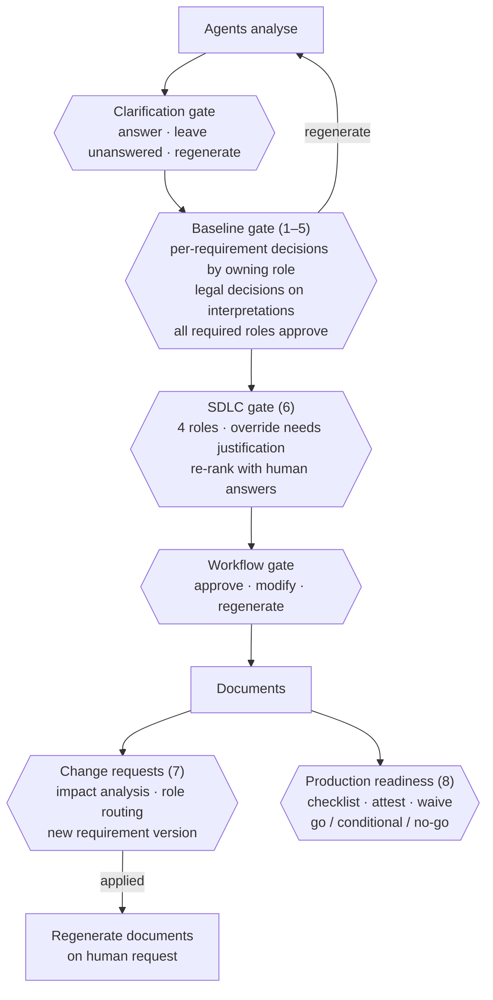

# Human in the loop (step 16)

> **Step 16 of the problem statement.** "Human approval should be mandatory for: final requirement baselines;
> regulatory interpretations; high-risk security requirements; conflicting stakeholder decisions; architecture-critical
> requirements; SDLC selection; changes to approved requirements; production-readiness decisions. Users must be able to
> accept, reject, modify, or request regeneration of AI outputs."

This guide lists every place where the system stops and a person decides. For each one it covers who decides, what
they can do, how the rule is enforced, and where the decision is recorded.

**AI outputs are proposals.** Nothing an agent produces becomes part of the approved baseline, the SDLC decision, the
workflow or a production release until the people accountable for it have decided. The rules are enforced in code (the
API refuses with 403/422), not just shown in the UI. Every decision is written to the audit log with the person, the
role and the time.

## 1. The controls at a glance

| # | Mandatory decision (step 16) | Where | Who decides | Actions |
|---|---|---|---|---|
| 1 | **Final requirement baselines** | Baseline approval gate | The baseline owner (product owner) plus every role the content requires | Accept, reject or modify each requirement; approve; request regeneration |
| 2 | **Regulatory interpretations** | Baseline gate › Compliance tab | Compliance & legal | Accept, reject or modify each interpretation |
| 3 | **High-risk security requirements** | Baseline gate | Information security | Accept, reject or modify each one |
| 4 | **Conflicting stakeholder decisions** | Baseline gate | Baseline owner (product owner) | Accept, reject or modify each conflicting requirement |
| 5 | **Architecture-critical requirements** | Baseline gate | Architect | Accept, reject or modify each one |
| 6 | **SDLC selection** | SDLC approval gate | Project manager, architect, information security, compliance & legal | Approve; choose another model (with justification); correct the inputs and re-rank; request regeneration |
| — | Project SDLC workflow (step 15 output) | Workflow approval gate | Project manager, information security, compliance & legal | Approve; modify phases and timeline; request regeneration |
| 7 | **Changes to approved requirements** | Governance › change requests (after completion) | Product owner, project manager, plus the roles the change affects | Propose; approve; reject; request changes; revise |
| 8 | **Production-readiness decisions** | Governance › readiness reviews (after completion) | Project manager, operations, information security, compliance & legal | Go; conditional go; no-go; attest; waive with justification |

The live status of every control for a project is shown on **Project › Governance** (`GET /projects/{id}/hitl`),
with the evidence: who decided what, and when.

## 2. Final requirement baselines (control 1)

The baseline gate (`app/agents/approval.py::baseline_approval`) pauses the analysis graph.

**Who approves.** The human-approval agent routes the baseline according to its content:

| Approver | When required |
|---|---|
| Product owner | Always: they own the baseline |
| Compliance & legal | Regulatory requirements, escalated requirements, or interpretations needing legal review |
| Information security | High-severity security findings or high security risks |
| Architect | Must-have integration, performance or availability requirements |
| Any other role | When it owns a decision (§3) |

The graph loops until every required role has approved.

**What approvers can do:**
- **Accept, reject or modify** any requirement. A modified statement keeps the original (`original_statement`).
- **Approve** the baseline.
- **Request regeneration** with feedback. The analysis re-runs with the feedback in the extraction prompt, and
  earlier approvals are cleared.

**Agent suggestions don't slip in.** Suggested requirements from the security and compliance agents (`SUG-…`) only
join the baseline if a human accepts them.

## 3. Requirements whose decision belongs to one role (controls 3, 4, 5, and part of 2)

Some requirements need an **explicit** accept, reject or modify from the role accountable for them. Approving the
whole baseline isn't enough. `app/hitl/controls.py::decision_items` selects them and assigns an owner (the first
matching rule wins):

| Requirement | Owner | Control |
|---|---|---|
| Proposed by the compliance agent to close a compliance gap; or escalated by grounding because it contradicts an approved source or is regulatory, privacy or audit | Compliance & legal | Regulatory interpretations |
| High-risk security: a security requirement with a high risk level, or a suggestion from a high-severity security finding | Information security | High-risk security |
| In conflict with another stakeholder's requirement (a conflict between different roles) | Baseline owner | Conflicting stakeholder decisions |
| Architecture-critical: must-have integration, performance or availability requirement | Architect | Architecture-critical |
| Any other escalated requirement (unsupported, low confidence) | Baseline owner | Baseline |

**Enforcement** (`POST /projects/{id}/decision`):
- A decision on a requirement owned by another role is refused (**422**, "must be decided by their owning role").
- A role cannot approve while it still has undecided requirements (**422**, listing them).
- In the UI, each requirement shows "decision by …" with its reasons. The approve button names the items still open
  for the selected role.

Each decision is stored on the requirement (`decision: {action, by, role, at}`) and shows in the register.

## 4. Regulatory interpretations (control 2)

The compliance agent proposes how requirements map to regulations (step 11). **It never makes a legal
determination.** Every mapping that needs legal review becomes an *interpretation* with an ID (`MAP-01` …). A
mapping needs review when it is high-impact, its evidence is weak or missing, or it cites a passage that wasn't
retrieved.

- **Who.** Only compliance & legal can decide interpretations (**422** for anyone else). Compliance & legal cannot
  approve the baseline until every interpretation has a decision (**422**).
- **Accept.** The interpretation stands.
- **Reject.** It no longer applies. It drops out of the requirement's applicable regulations, the RTM and the workflow
  prompt.
- **Modify.** Correct the regulation or obligation text. The original is kept in `original`.
- **Recorded** as `legal_decision` on the mapping, with person and time; shown in the compliance matrix and the
  register.

## 5. SDLC selection (control 6)

The SDLC gate requires all four roles named in step 14: project manager, architect, information security, and
compliance & legal (`SDLC_APPROVERS`). Each can:

- **Approve** the recommended model (**accept**).
- **Choose another model** from the ranking (**reject or modify** the recommendation). A justification in the feedback
  is mandatory (**422** without it), and the approval is flagged `override` in the audit log.
- **Correct the inputs and re-rank**, by answering or correcting the course's selection questions; the project manager
  usually answers the team questions.
- **Request regeneration** with feedback.

Details are in [sdlc_selection_research_and_rules.md](sdlc_selection_research_and_rules.md) §8.

## 6. Project workflow (step 15 output)

The generated workflow is approved by the project manager, information security, and compliance & legal
(`WORKFLOW_APPROVERS`). They can:

- **approve** it;
- **modify** phases (durations and every list) and the iteration/cycle settings; mandatory controls are reinstated
  if an edit removes them;
- **request regeneration** with feedback.

See [sdlc_workflow_generation.md](sdlc_workflow_generation.md) §5.

## 7. Changes to approved requirements (control 7)

Once the analysis has completed, the approved baseline changes **only** through a change request
(`app/hitl/changes.py`, Project › Governance). Before completion, requirements are changed at the baseline gate
instead.

1. **Propose.** Anyone in a catalog role can propose to add, modify or remove a requirement, with a reason.
2. **Impact analysis** (deterministic). It lists:
   - dependent requirements;
   - use cases, user stories and acceptance tests;
   - regulations and risks;
   - workflow phases;
   - the documents to regenerate;
   - an impact level.
3. **Routing.** Product owner and project manager (`CHANGE_APPROVERS`), plus:
   - compliance & legal if the change touches regulatory, privacy or audit requirements or mapped regulations;
   - information security for security or privacy;
   - the architect for integration, performance or availability.
4. **Decide.** Each required role approves, rejects or requests changes. Reject and request-changes need a comment.
   - Any rejection closes the request.
   - "Request changes" sends it back; the proposer revises it, and earlier approvals are cleared.
5. **Apply.** When every role has approved, the change becomes a **new requirement version**. Earlier versions are
   kept in `history`, with the change request that replaced them. A new requirement gets the next ID; a removed one is
   marked removed, not deleted. Both the graph state and the requirements table are updated.
6. **Regenerate.** The project becomes `artifacts_stale`. The documents are regenerated only when a person asks
   (`POST /projects/{id}/artifacts/regenerate`); nothing is silently rewritten.

## 8. Production-readiness decisions (control 8)

Before a release goes to production, a readiness review (`app/hitl/readiness.py`) collects a go, conditional go or
no-go from each readiness approver: project manager, operations, information security, and compliance & legal
(`READINESS_APPROVERS`). The step-15 workflow points to it: the last release gate is marked "production readiness".

**Checklist.** Every item has an owner role.

*Automatic checks* are re-evaluated from the approved state at every decision:
- baseline approved;
- every owned decision recorded;
- every regulatory interpretation decided;
- SDLC approved by all four roles;
- workflow approved;
- the mandatory security and compliance controls present in the workflow (checked with the same rules that generated it);
- no blocking clarification left open;
- no pending change request;
- documents up to date.

*Attestations* only a person can give:

| Attestation | Owner |
|---|---|
| All tests (including transaction integrity) passed | Project manager |
| UAT signed off | Project manager |
| SAST clean and pen-test findings closed | Information security |
| Runbooks, monitoring, backup/restore and rollback tested | Operations |
| Evidence filed for every regulatory obligation | Compliance & legal |

**Rules:**
- A role can say **go** only when every item it owns passes, is attested by it, or is **waived** by it with a written
  justification (**422** otherwise).
- A role can attest or waive only its own items.
- **Conditional go** needs the conditions; **no-go** needs the reasons.
- Any no-go rejects the review. Go from every role approves it; it is marked *approved with conditions* if any were
  conditional.

## 9. Accept, reject, modify, regenerate: every AI output

| AI output | Accept | Reject | Modify | Regenerate |
|---|---|---|---|---|
| Extracted requirements | Accept at the baseline gate | Reject | Edit the statement | Baseline "request regeneration" with feedback |
| Agent-suggested requirements (`SUG-…`) | Accept | Reject (or leave out) | Edit | As above |
| Regulatory interpretations | Accept | Reject | Correct regulation or obligation | As above |
| Clarification questions | Answer it (added as a source) | Leave it unanswered or skip | Answer with the corrected premise | "Regenerate analysis" with feedback |
| SDLC recommendation | Approve | Choose another model (with justification) | Correct the selection answers and re-rank | Request regeneration with feedback |
| Project workflow | Approve | Request regeneration | Edit phases and timeline | Request regeneration with feedback |
| Grounded answers (knowledge base › Ask) | Confirm in the review queue | Dismiss | Correct, with the corrected answer | Ask again |
| Knowledge-base items | Approve (by the collection's approver role) | Reject | Submit a new version | — |
| Documents (SRS, stories, use cases…) | Generated only from approved inputs | Change the inputs through a change request | Change request | Regenerate on request |

## 10. What runs without a person, and why that is safe

These steps run automatically, but each produces a **draft** that has to pass a human gate before it has any effect:

- extraction, classification and the analysis agents;
- grounding and validation;
- SDLC scoring and workflow drafting;
- document generation.

Deterministic code (routing, rules, scoring, the scheduler, impact analysis) can only *add* checks and approvers. It
cannot approve anything.

## 11. Enforcement and audit

| Check | Response |
|---|---|
| Approving or regenerating as a role that is not a required approver of that gate | 403 |
| Deciding a requirement owned by another role; approving with own decisions open | 422 |
| Interpretations decided by anyone but compliance & legal; compliance approving with interpretations open | 422 |
| Modify without new text; regenerate without feedback | 422 |
| Choosing a model other than the recommendation without a justification | 422 |
| Workflow edits to unknown phases or settings | 422 |
| Change-request decisions by a non-approver; reject or request-changes without a comment | 422 |
| Readiness go with own items open; attesting or waiving another role's item; waiver without justification | 422 |

**Masking.** All free text from people (feedback, statements, comments, waivers) is masked for personal data before
it is stored or reaches an LLM.

**Audit events:**
- clarification: `clarifications_answered`, `clarification_skipped`, `clarification_regenerate`;
- baseline: `baseline_approve`, `baseline_regenerate`, `legal_interpretations_decided`;
- SDLC: `sdlc_approve` (with `override_of_recommendation`), `sdlc_regenerate`;
- workflow: `workflow_approve`, `workflow_modified`, `workflow_regenerate`;
- change requests: `change_requested`, `change_approve`, `change_reject`, `change_request_changes`, `change_revised`,
  `change_applied`;
- documents: `artifacts_regenerated`;
- readiness: `readiness_review_opened`, `readiness_go`, `readiness_conditional`, `readiness_no_go`,
  `production_readiness_decided`.

**Limitation: roles are self-declared.** There is no sign-in yet. A person chooses the role they act as, so the
rules guarantee *that* the accountable role decided, not *who* the person really is. Adding authentication and
role-based access control (RBAC) is the next step before production use; the checks above already use the role, so
they will apply unchanged.

## 12. Configuration

| Setting | Default |
|---|---|
| `BASELINE_OWNER_ROLE` | `product_owner` |
| `SDLC_APPROVERS` | project_manager, architect_developer, infosec, compliance_legal |
| `WORKFLOW_APPROVERS` | project_manager, infosec, compliance_legal |
| `CHANGE_APPROVERS` | product_owner, project_manager (plus roles by impact) |
| `READINESS_APPROVERS` | project_manager, operations, infosec, compliance_legal |
| `MAX_CLARIFICATION_ROUNDS` | 2 |

## 13. Tests

**`tests/test_flow.py`**, one complete project:

- **Baseline:**
  - decisions owned by infosec, the architect and compliance;
  - refusals for a foreign decision, an open own decision, and an interpretation decided by the wrong role;
  - a legal "modify" with the original kept;
  - a regenerate.
- **SDLC:** an override refused without a justification, then accepted with one.
- **Workflow:** gate edits, with a removed control reinstated; a regenerate.
- **Change requests:**
  - one sent back, revised, approved by three roles and applied as version 2;
  - one rejected;
  - document regeneration.
- **Readiness:**
  - go refused until attested;
  - attesting another role's item refused;
  - a conditional go;
  - waivers;
  - approved with conditions.
- **Register:** all controls, with evidence.

**`tests/test_workflow_hitl.py`:** ownership rules for every kind of decision, and the register covering all eight
step-16 controls.
