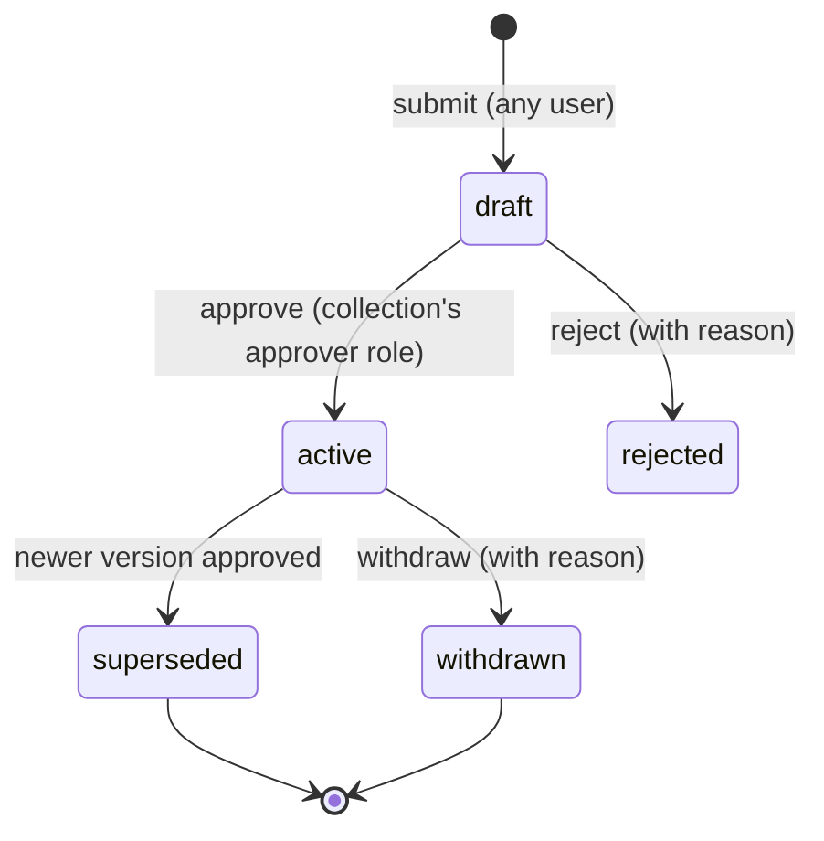

# Knowledge base

The knowledge base implements problem-statement **step 5** ("an authorised and version-controlled knowledge base…
every knowledge item should include its source, jurisdiction, effective date, version, and applicability") and the
retrieval half of **step 6**. How the six step-6 stages are implemented on top of it is in
[retrieval_grounded_generation.md](retrieval_grounded_generation.md). It lives in
the same PostgreSQL + pgvector database as the rest of the system; no external vector service or account is needed.

Code: `app/kb/` · API: `app/api/kb_routes.py` (`/kb/*`) · UI: **Knowledge base** page · seed content: `knowledge_base/`

## 1. What is stored: eight collections

| Collection (`collection`) | Step-5 item | Contents | Approved by | How agents get it |
|---|---|---|---|---|
| `regulation` | Regulatory requirements | Laws, regulator directions, circulars | Compliance & legal | Hybrid search |
| `policy_control` | Organisational policies and controls | Institution policies, control standards | Compliance & legal, risk, infosec | Hybrid search |
| `security_standard` | Security standards | PCI DSS, OWASP ASVS, NIST… (full text if licensed, else summaries) | Infosec | Hybrid search |
| `glossary_process` | Financial terminology and business processes | Glossary (one entry per term) + domain process descriptions | BA, product owner | Exact term lookup + hybrid search |
| `re_guideline` | Requirement-engineering guidelines | Writing rules, EARS patterns, MoSCoW, acceptance criteria | BA | Fetched in force by key |
| `sdlc_rule` | SDLC selection rules | 10 model profiles with execution profiles, course selection matrices and 30 sourced rules (YAML; see sdlc_selection_research_and_rules.md) | Project manager, architect, product owner | Fetched in force by key |
| `template` | Templates for SRS, user stories, use cases | The three templates | BA, product owner | Fetched in force by key |
| `project_history` | Previously approved project documents | Each completed project's approved SRS (masked) | Product owner | Hybrid search |

**Retrieval-source allowlisting (step 17).** Each agent may only read its own collections (`AGENT_ALLOWLIST` in
`app/kb/collections.py`). A request for any other collection is ignored, so (for example) the compliance agent cannot
cite a past project as if it were regulation.

| Agent | Collections it may search | What it uses them for |
|---|---|---|
| Compliance | regulation, policy_control, security_standard | Map requirements to clauses with citations; find gaps |
| Grounding | regulation, policy_control, security_standard | Per-requirement evidence, support verdict, citations, confidence, escalation |
| Security & privacy | security_standard, policy_control, regulation | Ground missing-control findings in standards/policies |
| Risk analysis | policy_control, project_history | Risk appetite, limits, continuity controls |
| Clarification | glossary_process, project_history | Don't ask about defined terms; ask about undefined ones; spot topics past projects covered |
| Extraction | (lookup) re_guideline | Requirement-writing rules added to every extraction prompt |
| Validation | (lookup) glossary | Flags acronyms not defined in the glossary (step 10 "undefined terminology") |
| Documentation | (lookup) template | User-story and use-case templates; records template versions used; feeds `project_history` |
| SDLC selection | (lookup) sdlc_rule | Loads the in-force rules version; records which version ranked the models |

## 2. Metadata on every item (step 5)

Validation (`ItemMetadata` in `app/kb/ingest.py`) makes the five required attributes **mandatory**; an item missing
any of them is rejected with a 422.

| Step-5 attribute | Fields | Rule |
|---|---|---|
| **Source** | `issuer`, `source_url`, `license` (`full_text` / `summary_only` / `internal` / `sample`), `content_sha256` | Issuer required; URL/citation required for external documents; hash of the exact text ingested |
| **Jurisdiction** | `jurisdictions[]` — `IN`, `EU`, `UK`, `US`, `GLOBAL` | At least one |
| **Effective date** | `effective_from`, `effective_to`, `review_due` | `effective_from` required; `effective_to` set automatically when superseded or withdrawn |
| **Version** | `version`, grouped by `doc_key` | Required; unique per `doc_key`; history is never overwritten |
| **Applicability** | `applicability.domains[]` (or `["all"]`), `entity_types[]`, `products[]`, `roles[]` | Domains required; unknown domains/roles rejected |

Plus: `collection`, `title`, `status`, `submitted_by`, `approved_by`, `approved_role`, `approved_at`, `redactions`,
`section_count`, `chunk_count`, `embedding_model`, `notes`. Every passage inherits these through its document, and its
context header carries the title, version and location, so every citation can show all five attributes.

## 3. Tables

```mermaid
erDiagram
    kb_documents ||--o{ kb_chunks : "has passages"
    kb_chunks ||--o{ kb_chunks : "parent → children"
    kb_documents ||--o{ kb_terms : "glossary entries"
    projects ||--o{ kb_impacts : "flagged by"
    kb_documents { int id; string doc_key; string version; string collection; string issuer; string license; jsonb jurisdictions; jsonb applicability; date effective_from; date effective_to; string status; string approved_by; text content; string content_sha256 }
    kb_chunks { int id; string kind; int parent_id; jsonb section_path; string clause_ref; text context_header; text content; int token_count; vector embedding; tsvector tsv }
    kb_terms { int id; string term; string acronym; text definition }
    kb_embedding_cache { string content_sha256; string model; vector embedding }
    kb_impacts { int id; int project_id; string doc_key; string old_version; string new_version; string change; jsonb cited_refs; string status }
```

## 4. Ingestion: from document to searchable passages

```
upload / seed ─▶ parse (PDF, DOCX, MD, TXT, YAML) ─▶ validate metadata ─▶ mask (policies, project history)
   ─▶ detect structure ─▶ parent/child chunks ─▶ context headers ─▶ embed (cached) ─▶ index ─▶ DRAFT
```

**Structure detection** (`app/kb/chunking.py`) recognises markdown headings, `Chapter / Part / Schedule / Annex`,
`Section / Article / Para / Clause / Rule n`, and numbered headings such as `5.1 Record retention`. Each section keeps
its path (e.g. `CHAPTER VI › Para 38 Periodic updation`) and clause reference (`Para 38`, `5.1`).

**Parent–child chunking ("small-to-big").**
- *Parent* = a section (or ≤ 1,500-token slice of a long one). This is what an agent reads as evidence.
- *Child* = a ~350-token (max 500) passage inside the parent. This is what search matches and what is embedded.
- Splits fall on paragraph and clause boundaries. Sub-clauses `(a)`, `(b)`, `(i)` stay with their lead paragraph and
  tables are never split. Only an oversized single clause is split by sentences, with ~10 % overlap.
- Glossary documents are chunked one term per passage and also written to `kb_terms` for exact lookup.
- Templates and SDLC rules are stored whole (`chunking: whole`) and fetched by key, never searched.

**Context headers.** Each passage is embedded as `"<Title> (v<version>) › <Chapter> › <Para>\n<text>"`. Short clauses
("records shall be preserved for five years") become retrievable by topic and document, and the header is also part
of the full-text index.

**Embedding cache.** Embeddings (`text-embedding-3-small`, 1536 dimensions) are cached by text hash + model in
`kb_embedding_cache`. A new version only pays for passages that actually changed; re-ingesting the same text costs nothing.
Token counts use the model's tokenizer (`cl100k_base`).

## 5. Indexes

| Index | Type | Serves |
|---|---|---|
| `ix_kb_chunks_embedding_hnsw` | pgvector **HNSW** (`vector_cosine_ops`, m = 16, ef_construction = 64; query `ef_search` = 80) | Approximate nearest-neighbour vector search |
| `ix_kb_chunks_tsv` | **GIN** on a generated `tsvector` (header + text, English) | Keyword search; exact terms and clause numbers ("KFS", "Para 38", "8.4.2") |
| `ix_kb_terms_term_trgm` | **GIN pg_trgm** on `lower(term)` | Fuzzy glossary lookup |
| `ix_kb_documents_filters` | B-tree (collection, status, effective_from, effective_to) | Pre-filtering by validity |
| `ix_kb_documents_jurisdictions`, `…_applicability` | GIN on JSONB | Jurisdiction and domain filters |

## 6. Retrieval pipeline (`app/kb/retrieval.py`)

```
query/queries ─▶ allowlist ─▶ filters ─▶ ┬ vector top-40 (HNSW)  ┐
                                         └ keyword top-40 (GIN)  ┴▶ Reciprocal Rank Fusion ─▶ rerank top-40
   ─▶ per-document cap (3) ─▶ de-duplicate parents ─▶ parent expansion ─▶ top-k with evidence strength
```

1. **Query rewriting (multi-query).** The compliance agent turns its requirement batch into 2–4 focused queries
   (`rewrite_queries`); the security agent uses fixed control topics. Each query is searched; results are fused.
2. **Metadata pre-filter.** Approved items only (`active`, or `superseded` while still within its dates), in force on
   the as-of date (`effective_from ≤ as_of < effective_to`), matching the project's **jurisdiction** (or `GLOBAL`) and
   **domain** (or `all`). Drafts, rejected and withdrawn items are never returned.
3. **Hybrid search.** Vector cosine search and Postgres full-text search (`websearch_to_tsquery`, `ts_rank_cd`) each
   return 40 child passages.
4. **Reciprocal Rank Fusion** (k = 60) merges both lists across all queries: `score = Σ 1 / (60 + rank)`.
5. **Reranking** of the fused top 40 (`app/kb/rerank.py`, setting `RERANKER`):
   - `cross_encoder` (default): local `BAAI/bge-reranker-base` via sentence-transformers — no data leaves the machine;
     about 1 s for 40 pairs on CPU after a one-time model download.
   - `llm`: the chat model scores relevance (no extra install, one call per search).
   - `none`: keep the fused order. If the cross-encoder cannot load, retrieval degrades to `none` instead of failing.
6. **Diversity and context.** At most 3 passages per document; one passage per parent; each hit is expanded to its
   parent section, which is what the agent reads.
7. **Evidence strength.** From the rerank score (or cosine similarity without a reranker): **strong / weak / none**.
   The compliance agent may only cite refs it was given; a mapping whose evidence is not *strong* (or that cites
   nothing) is flagged **needs legal review**. This is the step-6 "escalate unsupported or low-confidence outputs".

Each hit carries a citation such as `RBI KYC Master Direction v2024-11 §Para 38` plus issuer, jurisdictions, effective
dates, applicability, source URL and per-stage scores (vector rank, keyword rank, RRF, rerank). The UI's
**Retrieval tester** shows exactly this.

## 7. Authorisation and versioning



- **Submit** creates a draft and returns a **section-level diff** against the version currently in force (added /
  changed / removed / unchanged sections), which the approver sees in the document panel.
- **Approve** (only by the collection's approver roles) activates the draft and sets the previous version's
  `effective_to` to the new `effective_from`. A future-dated version is stored now and becomes the one retrieved on
  its effective date; until then the old one stays in force. Old versions are never deleted, so agents and auditors can
  query **as of** any past date.
- **Withdraw** ends an item's validity today (with a reason). **Reject** closes a draft.
- Everything is written to the audit log (`kb_submitted`, `kb_approved`, `kb_rejected`, `kb_withdrawn`).

## 8. Keeping it up to date (step 20: "update regulatory knowledge … re-evaluate")

| Situation | What to do | What the system does |
|---|---|---|
| A regulator amends a direction | Download the new text; submit it under the **same `doc_key`** with the new version and effective date | Diff shown to approver; on approval the old version is superseded from that date; only changed passages are re-embedded |
| The amendment applies from a future date | Submit with that `effective_from` | Both versions kept; retrieval switches automatically on the date |
| A document is repealed | Withdraw it with a reason | It stops being retrieved today |
| A superseded/withdrawn version was cited by an approved project | Nothing | `kb_impacts` row + audit event; the project page shows a "Regulatory change" banner; **Change impact** tab lists them until marked re-evaluated |
| Review date passes | Review and resubmit or confirm | Item shows "review overdue" in the library |
| A project completes | Nothing | Its approved SRS is added to `project_history` automatically |
| Embedding model changes | Change `EMBEDDING_MODEL` and resubmit | Cache is keyed by model, so new vectors are computed; each document records its embedding model |

## 9. Seeding

```powershell
.venv\Scripts\python -m app.kb.seed                             # authored items → drafts (approve them in the UI)
.venv\Scripts\python -m app.kb.seed --approve-as compliance_legal  # development: approve as each collection's approver
.venv\Scripts\python -m app.kb.seed --sources                   # + official documents listed in the manifest
.venv\Scripts\python -m app.kb.seed --embed                     # add vectors to items stored before a key was set
```

- `knowledge_base/seed/` — items written by the project team: financial glossary (~70 terms), loan-origination and KYC
  process descriptions, requirement-writing guidelines, SRS / user-story / use-case templates, six **sample** policies of
  a fictional bank (clearly labelled `license: sample`), and a security-control baseline summarising public standards
  (`license: summary_only`). SDLC rules are seeded from `app/catalog/data/sdlc_models.yaml`.
- `knowledge_base/sources/manifest.yaml` — official regulations and standards for the two active use cases (RBI digital
  lending, fair practices, KYC, IT governance, digital payment security; DPDP Act and Rules; PMLA; CERT-In; GDPR; FATF;
  PCI DSS; OWASP ASVS; NIST SP 800-63B). Regulatory text is **not** written from memory: download each document from its
  official source, save it in `knowledge_base/sources/`, fill in `version` and `effective_from` from the document, then
  run with `--sources`. Paywalled standards (ISO 27001, ISO/IEC/IEEE 29148) are only cited, never reproduced.

**Without `OPENAI_API_KEY`** items are still stored, approved and **keyword-searchable**. The full-text leg then adds
passages matching *any* query term after those matching all terms, and the cross-encoder reranker still orders the
results. Vectors are added later with `python -m app.kb.seed --embed`, and hybrid search switches on automatically once
they exist. The development database was seeded this way: 14 authored items plus the SDLC rules (now v2.2), all approved
by their collection's approver role.

## 10. Scope

Active domains: **loan processing** and **customer onboarding & KYC** (problem statement step 18: "begin with one
financial use case, such as loan processing or digital customer onboarding"). The other six domains are defined in the
catalog with `status: planned` and are enabled by changing one field once their knowledge is seeded.

## 11. Measuring retrieval quality (next step)

Build a golden set of ~60 questions for the two active domains, each with the clauses that should be retrieved, and
compare **vector-only vs hybrid vs hybrid + rerank** on Recall@8, MRR, nDCG@10 and citation correctness. Use the
results to calibrate the evidence-strength thresholds (`STRONG` / `WEAK` in `retrieval.py`), which are currently
reasonable defaults rather than tuned values.

## 12. Configuration

| Setting (`.env`) | Default | Meaning |
|---|---|---|
| `EMBEDDING_MODEL` | `text-embedding-3-small` | Embedding model (1536 dimensions) |
| `RERANKER` | `cross_encoder` | `cross_encoder` / `llm` / `none` |
| `RERANKER_MODEL` | `BAAI/bge-reranker-base` | Cross-encoder model (downloaded once, runs locally) |
| `KB_QUERY_REWRITE` | `true` | Multi-query rewriting for the compliance agent |
