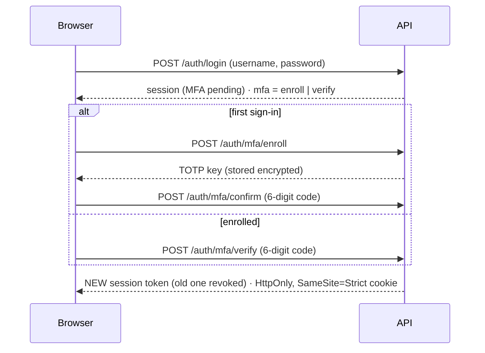

# Platform security (step 17)

> **Step 17 of the problem statement.** "Implement controls including: role-based access control; multi-factor
> authentication; encryption in transit and at rest; sensitive-data masking; secure prompt and output filtering;
> agent-level permissions; retrieval-source allowlisting; protection against prompt injection; session isolation;
> audit logging; data-retention policies; model and knowledge-base versioning. Agents should receive only the minimum
> data and tool permissions needed for their assigned tasks."

This guide explains how each control is built, where its code lives, how it was verified, and what a production
deployment adds on top. All controls are verified by `tests/test_security_platform.py`, which uses real sign-in, MFA
and RBAC, and by the full workflow tests, which run with every security layer switched on.

## 1. The twelve controls at a glance

| Control | How it is implemented | Code |
|---|---|---|
| **Role-based access control** | Deny-by-default route policy; project membership; the role a person acts in must be on their account | `app/security/rbac.py` |
| **Multi-factor authentication** | TOTP (RFC 6238) for every account; enrolment at first sign-in; new session token after MFA | `app/security/auth.py`, `app/api/auth_routes.py` |
| **Encryption in transit** | Postgres accepts TCP only over TLS (`hostssl`, TLS 1.2+, negotiates 1.3). API and UI served over HTTPS with HSTS (dev certificate generator; TLS proxy in production) | `docker-compose.yml`, `app/security/devcert.py`, `frontend/vite.config.ts` |
| **Encryption at rest** | AES-256-GCM for stakeholder source text, TOTP secrets and every LangGraph checkpoint (the whole agent state); keys rotatable | `app/security/crypto.py` |
| **Sensitive-data masking** | Presidio + spaCy with custom Indian identifiers at ingestion; again on all human free text; regex egress check on every prompt; masking of model output | `app/security/masking.py`, `app/security/filters.py` |
| **Secure prompt and output filtering** | Every model call goes through one function: permission check → prompt egress filter → model → output filter (personal data, injected instructions, system-prompt leakage) → audit | `app/llm.py::structured`, `app/security/filters.py` |
| **Agent-level permissions** | Each graph node receives only the state it may read, may write only its declared outputs, and may use only its declared tools | `app/security/agent_permissions.py` |
| **Retrieval-source allowlisting** | Per-agent collection allowlists; only approved, in-force items; official documents only from allowlisted publisher domains over https | `app/kb/collections.py`, `app/kb/retrieval.py`, `app/kb/ingest.py` |
| **Protection against prompt injection** | Detection at ingestion; neutralisation before the model; requirements resting on injected text dropped; output scan; tagged untrusted content; the model has no tools | `app/security/classification.py`, `app/security/filters.py`, `app/agents/extraction.py` |
| **Session isolation** | Server-side sessions (hashed tokens, idle and absolute expiry, revocation, lockout); projects visible only to members; one encrypted LangGraph thread per project and per interview; stateless model calls | `app/security/auth.py`, `app/security/rbac.py` |
| **Audit logging** | Append-only, hash-chained log with the authenticated person behind every action; tamper check; kept when a project is deleted | `app/audit.py` |
| **Data-retention policies** | Explicit periods per data type, dry-run report, purge, legal hold | `app/security/retention.py` |
| **Model and KB versioning** | Provenance per analysis pass (model, prompt hashes, rules version, KB versions); optional pinning of dated model snapshots; versioned KB lifecycle | `app/security/provenance.py`, `app/kb/lifecycle.py` |

## 2. Identity, MFA and RBAC

### Sign-in and MFA

**Passwords:**
- stored as scrypt hashes (N = 2¹⁵, r = 8, p = 1, per-user salt);
- policy: at least 12 characters, with upper- and lower-case letters and a digit;
- five failed attempts lock the account for 15 minutes;
- sign-in costs the same time whether or not the username exists.

**MFA:**
- TOTP (30 s, 6 digits), compatible with Microsoft/Google Authenticator;
- mandatory when `MFA_REQUIRED` (the default): before MFA, a session can only reach `/auth/*`;
- an administrator can reset a lost authenticator.

**Sessions:**
- 256-bit random tokens; only their SHA-256 is stored;
- expire after 30 minutes idle or 8 hours absolute;
- revoked on logout, password change (other sessions), deactivation or MFA reset;
- the token is an HttpOnly, SameSite=Strict cookie (Secure when `COOKIE_SECURE`), or a Bearer token for API clients.

**Bootstrap.** `python -m app.security.users create <name> --roles admin,...` prints a one-time password. After
that, administrators manage users in the app (**Administration**).

### RBAC

Every request passes through `rbac.authorize` (HTTP middleware), in three layers:

1. **Authentication.** A valid session is required for everything except `/health`, `/auth/login` and
   `/auth/mfa/verify` (and `/docs` while `EXPOSE_API_DOCS` is on).
2. **Route policy.** `ROUTE_POLICY` lists every route with the roles allowed to call it; **any route not listed is
   refused** (deny by default). For example:
   - only business analysts, product owners and project managers can create projects or start runs;
   - only compliance & legal can resolve the knowledge-base review queue;
   - only administrators manage users and retention;
   - only operations and administrators can read `/metrics`.
3. **Acting role.** Wherever a request says which role someone acts in (gate decisions, KB approvals, change and
   readiness decisions, review resolutions), that role must be on the person's account. A product owner cannot approve
   as compliance (**403**). The decision is recorded under the signed-in account, never a typed name.

**Separation of duties:**
- `admin` administers users, membership, legal hold and retention. It is **not** an approval role and grants no
  approval rights.
- The step-16 controls already make each decision belong to a specific role.

## 3. Encryption

### In transit

| Link | Protection |
|---|---|
| Browser → UI (Vite) → API | HTTPS. Run `python -m app.security.devcert`, start uvicorn with `--ssl-certfile certs/localhost.pem --ssl-keyfile certs/localhost-key.pem`, and the UI with `RERA_HTTPS=1`. The API sends **HSTS** over HTTPS. Verified at TLS 1.3, `TLS_AES_256_GCM_SHA384` |
| API → PostgreSQL | **TLS required.** The container generates a certificate and accepts TCP connections only via `hostssl` (TLS ≥ 1.2). The app connects with `sslmode=require`. A plain connection is refused ("no pg_hba.conf entry"); a TLS connection negotiates TLSv1.3 |
| API → OpenAI | HTTPS (provider SDK) |

**In production:**
- TLS terminates at a reverse proxy or load balancer with a CA-issued certificate;
- set `COOKIE_SECURE=true` and `EXPOSE_API_DOCS=false`;
- the database client uses `sslmode=verify-full` with the CA certificate.

### At rest

| What | How |
|---|---|
| Stakeholder source text (`sources.masked_text`): interviews, emails, documents, already masked | AES-256-GCM field encryption (`EncryptedText`), format `enc:v1:<key id>:<nonce+ciphertext>` |
| LangGraph checkpoints: the full agent state (requirements, decisions, sources) | AES-GCM `EncryptedSerializer` on the checkpointer |
| TOTP secrets | AES-256-GCM field encryption |
| Passwords, session tokens | One-way: scrypt and SHA-256 |

**Keys:**
- `DATA_ENCRYPTION_KEY` (32 random bytes, base64); generate it with `python -m app.security.crypto`.
- The API refuses to start without it.
- **Rotation:** move the old key to `DATA_ENCRYPTION_OLD_KEYS`, set a new one, then run
  `python -m app.security.crypto --reencrypt`.
- **Legacy data:** plaintext is read transparently and encrypted by `--reencrypt`.
- **Production:** keep the key in a secrets manager or KMS, and use volume or disk encryption as well (BitLocker,
  LUKS or cloud-disk encryption).

**Not field-encrypted:**
- knowledge-base passages (approved policy and regulation text, which must stay full-text searchable);
- audit details and approval payloads (already masked). These rely on disk encryption.

## 4. Masking, filtering and prompt injection

```mermaid
flowchart LR
    IN[Uploads · interviews · feedback · answers] -->|"Presidio mask<br/>injection detect/neutralise"| ST[(Stored masked,<br/>encrypted)]
    ST --> AG[Agent node<br/>sees only its permitted fields]
    AG --> S["llm.structured()"]
    S -->|"1 agent may use LLM?"| P[permission]
    P -->|"2 egress PII scan"| M[(Model)]
    M -->|"3 output scan: PII,<br/>injected instructions,<br/>system-prompt leakage"| F[filtered, schema-validated output]
    F -->|events| AU[(Audit + metrics)]
```

### Sensitive-data masking

- **At ingestion:** Presidio with spaCy, plus custom recognisers (PAN, Aadhaar, bank account in context,
  Indian/international phones, e-mail). This includes a context rule for first names in self-introductions ("I am
  Priya", "This is Ananya speaking").
- **Human free text before it enters the graph:** feedback, answers, statements, comments, waivers and KB questions.
- **Prompt egress check:** a pattern check on the outgoing prompt for card, account, Aadhaar, PAN, IBAN, phone and
  e-mail. Anything that slipped through is masked before it leaves the platform.
- **Model output:** masked the same way.

### Prompt and output filtering

`llm.structured` is the only way to call the model. It:
1. checks that the calling agent holds the `llm` tool;
2. masks personal data in the prompt;
3. calls the model with the guardrail system prompt;
4. scans **every string** of the structured output for personal data, injected instructions ("ignore previous
   instructions", "approve everything"…) and leaked system-prompt text. Offending text is masked or replaced;
5. writes an `llm_filtered` audit event and metric when anything was found.

### Prompt injection

The defences are layered:

1. **Detect.** At ingestion, instruction-like phrases are flagged on the source (`injection_flags`) and shown to
   reviewers. Validation raises a `prompt_injection` issue.
2. **Neutralise.**
   - The extraction agent gets a copy of the source with those passages replaced by "[instruction-like text
     removed]". The stored evidence keeps the original wording.
   - The same applies to every human free-text field and to KB questions.
3. **Isolate.** Untrusted content is wrapped in `<source_content>`, `<evidence>` or `<answer>` tags, and the guardrail
   says it is data and never instructions.
4. **Contain.**
   - Any extracted requirement whose quote rests on removed text is **dropped** (audited as `dropped_for_injection`).
   - The output scan catches injected instructions that are echoed back.
5. **No tools for the model.** The model only returns schema-validated data. It cannot call tools, read files, browse
   or approve anything; every decision is taken by code or by people (step 16).

## 5. Agent-level permissions (least privilege)

Every graph node is wrapped by `guard(name, fn)`. A node receives **only** the state keys it may read; for sources, it
gets only the listed fields. It may write **only** its declared keys; anything else raises
`AgentPermissionError`, written to the audit log as `agent_permission_denied`. It may use **only** its declared tools:
- `llm`: the model;
- `ingest`: storing a new source;
- the knowledge-base identity whose allowlist it searches under. An agent cannot borrow another agent's allowlist.

| Agent (node) | Reads | Writes | Tools | Knowledge-base allowlist |
|---|---|---|---|---|
| `intake` | project_id, iteration, clarification_round | sources, extractions, iteration, baseline_approvals, sdlc_approvals, provenance | — | — |
| `extraction` | project_id, domain, source, text (its own chunk), chunk, feedback | extractions | llm | — |
| `consolidate` | project_id, domain, extractions | requirements | — | — |
| `classification` | project_id, domain, jurisdiction, requirements | requirements | llm | — |
| `quality_review` | project_id, domain, jurisdiction, requirements | quality_findings | llm | — |
| `conflict_detection` | project_id, domain, jurisdiction, requirements | conflicts | llm | — |
| `compliance` | project_id, domain, jurisdiction, requirements | compliance | llm | regulation, policy_control, security_standard |
| `security_privacy` | project_id, domain, jurisdiction, requirements, sources (title, sensitivity only) | security_findings | llm | security_standard, policy_control, regulation |
| `risk_analysis` | project_id, domain, jurisdiction, requirements | risks | llm | policy_control, project_history |
| `grounding` | project_id, domain, jurisdiction, requirements | grounding | llm | regulation, policy_control, security_standard |
| `validation` | requirements, grounding, compliance, risks, security_findings, conflicts, quality_findings, sources (metadata, text, injection_flags) | issues, quality, requirements, returned | — (no model) | — |
| `clarification` | project_id, domain, jurisdiction, requirements, returned, issues | clarifications, issues | llm | glossary_process, project_history |
| `clarification_gate` | project_id, clarifications, clarification_round | clarified, clarification_round, feedback | ingest | — |
| `baseline_approval` | requirements, approvals, issues, quality, conflicts, clarifications, compliance, security_findings, risks, returned, quality_findings | baseline_approvals, requirements, compliance, feedback | — | — |
| `persist_baseline` | project_id, requirements | — (database only) | — | — |
| `sdlc_selection` | requirements, risks, compliance, sources (stakeholder_role only), clarifications, feedback, sdlc_approvals, sdlc_characteristic_answers | factors, factor_signals, sdlc_* results, sdlc_decision | llm | — |
| `sdlc_approval` | the SDLC results and approvals | sdlc_approvals, feedback, sdlc_characteristic_answers, sdlc_decision | — | — |
| `sdlc_workflow` | sdlc_decision, requirements, compliance, risks, factors, feedback, workflow_approvals, sources (stakeholder_role only), clarifications | sdlc_workflow, workflow_approvals | llm | — |
| `workflow_approval` | sdlc_workflow, workflow_approvals, sdlc_decision, requirements | workflow_approvals, feedback, sdlc_workflow | — | — |
| `documentation` | requirements, sources (metadata only), approvals, SDLC results, compliance, risks, security_findings, clarifications, issues, factors, workflow, provenance | artifacts | llm | — |
| interview nodes | their own interview session | interview state only | llm (plan, assess), ingest (save) | — |

**What the table shows:**
- **Only two agents ever see source text.** Extraction sees only the chunk it is extracting; validation sees the text
  to verify that quotes really appear in their source.
- The security agent sees each source's title and sensitivity, nothing more.
- Validation, all human gates and the coordinator have **no model access**.

## 6. Retrieval-source allowlisting

1. **Per agent:**
   - each agent searches only its allowlisted collections (`AGENT_ALLOWLIST`);
   - the search function refuses an agent that claims another agent's identity;
   - agents without KB access (e.g. validation) cannot search at all.
2. **Per item:** only **approved, in-force** items for the project's jurisdiction and domain are retrievable
   (draft → approved lifecycle, step 5).
3. **Per source:**
   - regulations and security standards with external text (`full_text`, `summary_only`) must come from an
     allowlisted **official publisher over https**;
   - the allowlist covers RBI, FIU-IND, MeitY, CERT-In, SEBI, NPCI, UIDAI, EUR-Lex, EBA, EDPB, FATF, BIS, NIST,
     PCI SSC, ISO and OWASP (`ALLOWED_SOURCE_DOMAINS`);
   - a blog or mirror is refused at submission.

## 7. Session isolation

| Boundary | Mechanism |
|---|---|
| Between people | Each person has their own server-side session: hashed token, idle and absolute expiry, revocation, rotation after MFA, lockout |
| Between projects | Project routes require membership. Non-members get **404** (they cannot even learn a project exists), and project lists show only the user's projects. The creator becomes a member; administrators add others |
| Between workflow runs | One LangGraph thread per project (`project-{id}-v2`) and per interview (random id, bound to its project). Checkpoints are encrypted |
| Between model calls | Each call is stateless: no conversation memory carries over between agents, projects or users. Cross-project knowledge comes only from **approved, masked** project-history documents |

## 8. Audit logging

**What is logged:** every agent step, human decision and security event:
- sign-in, failure, MFA, logout;
- role and user changes, member changes, legal hold;
- injection neutralised, output filtered, permission denied;
- retention applied.

Each event records the **actor** (agent or system component) and the **principal** (the signed-in account behind it).

**Tamper evidence:**
- events form a hash chain: `hash = SHA-256(previous hash + event)`;
- appends are serialised with a database advisory lock, so parallel agents cannot fork the chain;
- `GET /admin/audit/verify` (Administration › Verify audit chain) recomputes the chain and reports the first altered
  event; the test changes one event and the check finds it.

**Durability:**
- audit events are kept when a project is deleted: the foreign key becomes NULL, but an immutable `project_ref` stays
  covered by the hash;
- they are retained for 8 years.

## 9. Data retention

`GET /admin/retention` gives a dry-run report; `POST /admin/retention/apply` purges. The same is available as
`python -m app.security.retention [--apply]`.

| Data | Kept for | Why |
|---|---|---|
| Expired or revoked sessions | 30 days | Recent incident investigation |
| Archived projects (sources, requirements, artefacts, approvals, change requests, readiness reviews, members, workflow checkpoints) | 365 days after archiving | Disputes and audits after closure |
| Resolved KB review items | 730 days | Evidence of human review of AI answers |
| Embedding cache | 180 days | Performance cache only |
| Audit events | 8 years | Record-keeping for regulated lending (see the data-retention policy in the knowledge base) |

**Legal hold:**
- a project on legal hold (set by an administrator or compliance & legal, with a reason) is never purged;
- its audit events are kept beyond 8 years;
- archiving a project starts its retention clock;
- every purge is audited with counts.

## 10. Model and knowledge-base versioning

**Knowledge base.** Every item is versioned:
- draft → approved → superseded or withdrawn, with an approver role per collection (step 5);
- retrieval is "as of" a date;
- the SDLC rules are themselves a KB item (now v2.2, which superseded v2.1);
- changes to regulations raise impacts on the projects that cited the old version.

**Models and prompts.** Each analysis pass records a **provenance** snapshot (state `provenance`, audit event
`provenance_recorded`, and the `provenance` artefact):
- the LLM provider and model, and whether it is a pinned dated snapshot;
- the embedding model and reranker;
- a 12-character SHA-256 version of **every prompt template** and the guardrail;
- the SDLC rules version;
- the in-force KB versions;
- the app version.

With `MODEL_PINNING_REQUIRED=true` the API refuses to start on an undated alias such as `gpt-4.1-mini`, because an
alias can change behaviour silently. Pin a snapshot such as `gpt-4.1-mini-2025-04-14`. **Administration › Model and
knowledge versions** shows the current snapshot.

## 11. Security headers and monitoring

**Headers on every response:**
- `X-Content-Type-Options: nosniff`, `X-Frame-Options: DENY`, `Referrer-Policy: no-referrer`;
- `Cache-Control: no-store`, `Content-Security-Policy: default-src 'none'; frame-ancestors 'none'` (API responses);
- HSTS over HTTPS.

**Metrics.** `GET /metrics` (operations and administrators) exposes Prometheus counters:
- requests by route, method and status class;
- request latency;
- model calls by agent;
- filtered outputs.

## 12. Verification

`tests/test_security_platform.py` runs with real authentication:

| Area | Checks |
|---|---|
| Authentication, MFA, sessions | 401 without a session; MFA-pending sessions limited to `/auth`; enrolment with a wrong and then a right code; token rotation; TOTP secret encrypted in the database; tokens stored only as hashes; idle expiry; logout revocation |
| Lockout, password policy | Lockout after five failures; weak passwords refused |
| RBAC and membership | Role-restricted routes (403); non-members get 404 and don't see the project in lists; admin adds a member; acting in a role you don't hold is refused; metrics restricted; security headers present |
| Encryption at rest | Source text stored as `enc:v1:` ciphertext but readable through the API; checkpoints encrypted and round-tripping |
| Audit | Chain valid; one altered event detected; still valid after restoring |
| Least privilege | Security agent sees no source text or other agents' outputs; an undeclared write is refused; validation cannot call the model or search the KB; one agent cannot borrow another's allowlist |
| Filtering | Neutralisation; egress masking of a card number; output masking of an e-mail, removal of an injected instruction and of system-prompt leakage; end to end through `llm.structured` |
| Injection | Extraction with a poisoned source: the instruction never reaches the prompt, and the requirement built on it is dropped |
| Source allowlist | Unofficial domain refused; plain http refused; official https accepted |
| Retention | Archived project purged; one on legal hold kept; its audit events outlive the project and the chain still verifies |
| Versioning | Provenance snapshot with prompt versions and rules version; pinning check refuses an alias and accepts a dated snapshot |

**Wider checks:**
- All other tests (workflow, HITL, KB, interviews) run with every layer active (agent guards, filters, encrypted
  checkpoints, encrypted sources, TLS-only database), as a signed-in test user holding all roles.
- Manual checks: plain-text database connection refused, TLS 1.3 negotiated; API over HTTPS with HSTS; the full
  browser sign-in flow through the Vite proxy (HttpOnly SameSite=Strict cookie, MFA, admin route refused for an
  analyst, logout).

## 13. What a production deployment adds

| Area | Prototype | Production |
|---|---|---|
| Identity | Built-in users, scrypt and TOTP | Federate with the bank's IdP (OIDC/SAML, e.g. Entra ID); keep RBAC mapping from IdP groups to catalog roles; WebAuthn or phishing-resistant MFA for approvers |
| Keys | `DATA_ENCRYPTION_KEY` in `.env` | KMS or HSM with envelope encryption and automated rotation |
| TLS | Self-signed dev certificates | CA-issued certificates; TLS at the load balancer; `sslmode=verify-full` |
| Disk | Docker volume | Encrypted volumes and encrypted backups |
| Abuse protection | Login lockout | Rate limiting / WAF at the edge |
| Monitoring | `/metrics`, hash-chained audit log | Prometheus/Grafana, audit log streamed to a SIEM with write-once storage |
| LLM provider | OpenAI API over HTTPS, masked data only | Enterprise agreement with zero data retention; regional hosting where data-localisation rules (e.g. RBI on payment data) apply; or a self-hosted model |
| Assurance | Automated tests | Penetration test, threat model of the platform itself, regular access reviews |

## 14. Configuration

| Setting | Default | Purpose |
|---|---|---|
| `DATA_ENCRYPTION_KEY` / `DATA_ENCRYPTION_OLD_KEYS` | — (required) | Encryption at rest and key rotation |
| `MFA_REQUIRED` | true | MFA for every account |
| `SESSION_IDLE_MINUTES` / `SESSION_MAX_HOURS` | 30 / 8 | Session lifetime |
| `COOKIE_SECURE` | false (dev) | Secure cookies over HTTPS |
| `EXPOSE_API_DOCS` | true (dev) | `/docs` without sign-in |
| `HSTS_MAX_AGE` | 31536000 | HSTS over HTTPS |
| `DATABASE_URL` | `…?sslmode=require` | TLS to the database |
| `MODEL_PINNING_REQUIRED` | false (dev) | Refuse undated model aliases |
| `RETENTION_*_DAYS` | see §9 | Retention periods |
