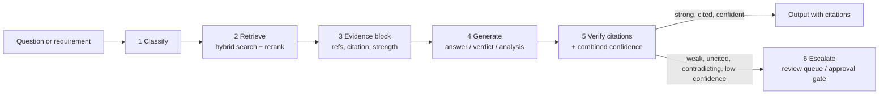

# Retrieval-grounded generation (step 6)

> **Step 6 of the problem statement.** "Use Retrieval-Augmented Generation to ensure that responses are grounded in
> approved sources. The workflow should be: 1. Classify the stakeholder query or requirement. 2. Retrieve relevant
> policies, regulations and domain documents. 3. Provide retrieved evidence to the LLM. 4. Generate the requirement or
> analysis. 5. Attach citations and confidence scores. 6. Escalate unsupported or low-confidence outputs for human review."

The system applies this workflow in two places:

| Path | Input | Where | Output |
|---|---|---|---|
| **A. Stakeholder questions** | A question in plain language ("How long must rejected applications be kept?") | `POST /kb/ask` → `app/kb/grounding.py::ground_answer`; UI: Knowledge base › **Ask** | A cited answer with a confidence score; escalated answers go to the **review queue** |
| **B. Requirements** | Every requirement extracted for a project | The **grounding agent** (`app/agents/grounding.py`), a node in the analysis graph | A support verdict, citations and a combined confidence for each requirement; escalated requirements must be decided by a human at the baseline gate |

Retrieval-grounded analysis also runs in the **compliance**, **security & privacy** and **risk** agents (§4).
The knowledge base itself (what is stored, how it is chunked, indexed and searched) is described in
[knowledge_base.md](knowledge_base.md).

## Step 1. Classify the stakeholder query or requirement

**Questions.** `classify_query()` asks the LLM for a `QueryClassification`:

- an **intent**: regulatory obligation, internal policy, security control, terminology, business process, requirement quality, SDLC, or out of scope;
- the **knowledge collections** that can answer it;
- 1–3 short **search queries**.

Out-of-scope questions retrieve nothing and are answered "no approved source answers this".

**Requirements.** The classification agent has already labelled every requirement with its categories, so routing
is deterministic (`COLLECTIONS_BY_CATEGORY`), with no extra LLM call:

| Requirement category | Collections searched |
|---|---|
| regulatory, audit | regulation, policy_control |
| privacy | regulation, policy_control, security_standard |
| security, integration | security_standard, policy_control |
| data | policy_control, regulation |
| business, operational | policy_control |
| availability | policy_control, security_standard |
| functional, usability, performance, stakeholder | — (product requirements; no grounding needed unless another category applies) |

Categories in `EVIDENCE_EXPECTED` (regulatory, privacy, security, audit, data) mark requirements where a missing source
is itself a problem.

## Step 2. Retrieve relevant policies, regulations and domain documents

Both paths call `app/kb/retrieval.py::search`, the same pipeline used everywhere:

1. **Allowlist.** Only the collections the caller may read (the grounding agent: regulation, policy_control, security_standard).
2. **Filter.** Approved items only, in force on the as-of date, for the project's jurisdiction (or GLOBAL) and domain (or all).
3. **Hybrid search.** Vector (HNSW) and keyword (full-text) search, merged with Reciprocal Rank Fusion.
4. **Rerank.** Cross-encoder reranking.
5. **Expand.** Each match is expanded to its parent section.

Requirements are retrieved **one by one** (top 3 passages each), so each verdict is judged against evidence for that
specific requirement rather than a shared pool.

## Step 3. Provide retrieved evidence to the LLM

Evidence is formatted by `evidence_block()`. Every passage is labelled with:

- its **ref** (`KB-123`);
- a human-readable **citation** (`Retail credit policy (SAMPLE) v2026.1 §5.2`);
- issuer, jurisdiction, effective date and **evidence strength**;
- the parent-section text.

The prompt wraps it in `<evidence>` tags. The shared system guardrail (`app/llm.py`) tells the model that tagged
content is untrusted data and that it must not invent facts or citations.

## Step 4. Generate the requirement or analysis

| Path | The LLM produces | Schema |
|---|---|---|
| Question | An answer built only from the evidence, broken into **claims**, each listing the refs that support it; an `insufficient_evidence` flag; the model's confidence | `GroundedAnswer` |
| Requirement | A **support verdict** per requirement: `supported`, `partially_supported`, `unsupported` (an obligation was expected but nothing was found), `contradicts_evidence` (conflicts with a policy or regulation, e.g. an auto-approval limit above the credit policy's), or `no_obligation_expected` (a product feature), plus refs, a one-line note and the model's confidence | `GroundingResult` (batches of 8) |
| Compliance / security / risk analysis | Mappings, findings and risks that cite evidence refs | `ComplianceResult`, `SecurityResult`, `RiskResult` |

## Step 5. Attach citations and confidence scores

**Citations are verified, not trusted.** Each ref the model returns is checked against the passages actually retrieved
for that request:

- A ref that wasn't retrieved is removed and recorded (`dropped_refs` / `invalid_refs`), which counts as a hallucination signal.
- Valid refs are turned into full citations (title, version, clause, issuer, strength).

**Confidence is computed, not self-reported.** Evidence factor: strong = 1.0, weak = 0.6, none = 0.25.

| Output | Formula |
|---|---|
| Answer | `model confidence × evidence factor of the best cited passage × share of claims with a valid citation`, and 0 if evidence is insufficient |
| Requirement (needs grounding) | `½ × extraction confidence + ½ × (verdict weight × model confidence × evidence factor)`. Verdict weights: supported 1.0, partially 0.7, unsupported 0.3, contradicts 0.1 |
| Requirement (`no_obligation_expected`) | The extraction confidence |

The requirement keeps both numbers, `extraction_confidence` and the combined `confidence`. The baseline review shows
both, and the combined score feeds validation's low-confidence rule.

**Where citations end up:**
- each requirement (`citations`, `grounding_support`), saved in the `requirements` table;
- the SRS ("*Grounded in:* … [KB-…]");
- the traceability matrix ("Grounded in", "human-reviewed");
- compliance mappings (`citation`, `evidence_strength`) and security findings (`citation`);
- the audit log (`grounded_requirements`, `grounded_answer`, `mapped_compliance`).

A new quality score, **grounding**, is the share of requirements that need a source and actually have one.

## Step 6. Escalate unsupported or low-confidence outputs for human review

| Output | Escalated when | Where it goes | What the human does |
|---|---|---|---|
| Requirement | `contradicts_evidence`; or `unsupported` in an evidence-expected category; or combined confidence < `GROUNDING_CONFIDENCE_THRESHOLD` (0.6) | Marked `escalated` with reasons, listed in the **baseline approval** gate, highlighted in the review table; compliance & legal becomes a required approver | Must **accept, modify or reject** each escalated requirement. The API rejects an approval that leaves any undecided (422), and the UI disables Approve until they are decided |
| Answer to a question | Insufficient evidence; any claim without a valid citation; a citation to a passage that wasn't retrieved; confidence < 0.6 | `review_queue` table, Knowledge base › **Review queue** | Confirm, correct (with the corrected answer) or dismiss; recorded with reviewer, role and time |
| Compliance mapping | Evidence not *strong*, cites nothing, or cites a passage that wasn't retrieved | `needs_legal_review`, listed under the gate's Compliance tab; compliance & legal becomes a required approver | Reviews it as part of the baseline approval |
| Security finding | High severity | `security_gap` issue; infosec becomes a required approver | Accepts or rejects the suggested control |

Every escalation and every human decision is written to the audit log, so the path from AI output to accountable
human decision is traceable (problem-statement "accountability" and "human oversight" challenges).

## Where it sits in the agent graph

The grounding agent runs **in parallel** with clarification, conflict detection, compliance, security & privacy and
risk analysis, right after classification. All six join at **validation**, which merges the grounding verdicts into
the requirements, raises `contradicts_policy` and `escalated` issues, and recomputes the quality scores. See
[architecture.md §4](architecture.md).

## How this reduces hallucination and improves traceability

- **Closed-book generation.** The model only sees approved, in-force passages and is told to say when they don't answer.
- **Verified citations.** Refs are checked against what was retrieved; invented refs are removed and counted.
- **Calibrated confidence.** The model's confidence is discounted by evidence strength and citation coverage.
- **Mandatory human decisions** on everything unsupported, contradicting or uncertain.
- **Full lineage.** Requirement → source quote → stakeholder → knowledge-base passage (title, version, clause, effective date) → approver.

## Tests

- `tests/test_grounding.py`
  - The confidence and escalation formulas.
  - A cited answer, with the question masked before the LLM sees it.
  - A hallucinated citation and an out-of-scope question, both escalated.
  - Review-queue resolution, where a correction requires the corrected text.
- `tests/test_flow.py`, the full graph:
  - The grounding verdict and citations on requirements.
  - A citation to a passage that wasn't retrieved, dropped.
  - Combined versus extraction confidence.
  - The baseline approval refused (422) until escalated requirements are decided.
  - Citations in the SRS and the traceability matrix.

## Configuration

| Setting | Default | Meaning |
|---|---|---|
| `GROUNDING_CONFIDENCE_THRESHOLD` | `0.6` | Below this combined confidence, outputs are escalated |
| `RERANKER` | `cross_encoder` | Determines how evidence strength is scored (see knowledge_base.md §6) |

The thresholds and evidence factors are sensible defaults. They should be calibrated on the golden evaluation set
(knowledge_base.md §11) once real regulations are loaded.
