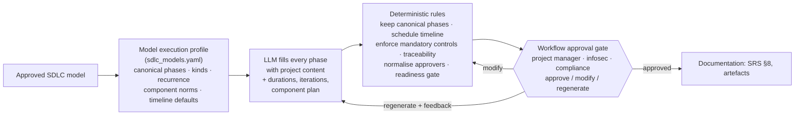

# Project-specific SDLC workflow (step 15)

> **Step 15 of the problem statement.** "The system should customise the selected SDLC with: development phases,
> activities within each phase, responsible roles, expected deliverables, security activities, testing requirements,
> compliance checkpoints, human-approval gates, entry and exit criteria, traceability requirements. For a financial
> application, the generated workflow might include threat modelling during design, static security testing during
> implementation, transaction-integrity testing during validation, and compliance approval before deployment."

Once the SDLC model is approved (step 14), the **workflow agent** (`app/agents/workflow.py`) customises it into a
plan for this project. The plan says, for every phase, **what** happens, **who** does it, **when** it runs on the
timeline, and **how** security, testing, compliance, approvals and traceability work under that model.

**Each model runs differently.** In Waterfall, testing happens once, after the build. In Scrum, it happens inside
every sprint. In DevSecOps, it runs on every commit. In the V-Model, each test level is designed early and executed
late. The workflow therefore follows the chosen model's own structure.

## 1. How it is generated

| Layer | Who | What |
|---|---|---|
| **Model profile** | `sdlc_models.yaml`, one per model | The model's canonical phases, in order. Each phase lists **what it does** (kinds: requirements, design, implementation, testing, validation, release, operation, plan, review, risk, prototype) and **when it runs** (`once`, `per_iteration`, `per_release`, `per_cycle`, `continuous`). It also gives V-Model pairings, the model's structure, the default number and length of iterations or cycles, and how each component normally runs under the model |
| **Project content** | LLM | Fills **every** canonical phase. The prompt contains the model's profile, the baseline requirements, the regulations (only those compliance & legal did not reject), the top risks, the schedule and budget signals, and any reviewer feedback |
| **Rules** | `finalise()` + `app/rules/workflow.py` | Make the result structurally correct and compliant, whatever the LLM wrote (§3) |
| **Human control** | Workflow approval gate | People accept, change or regenerate the plan (§5) |

## 2. The ten model profiles

The table below is generated from `sdlc_models.yaml`. ↔ marks the V-Model's paired test level.

| Model | Structure | Phases (what they do · when they run) | Defaults |
|---|---|---|---|
| **Waterfall** | sequential | Requirements · requirements · once Design · design · once Implementation · implementation · once Verification · testing, validation · once Deployment · release · once Maintenance · operation · continuous | — |
| **V-Model** | v_paired | Requirements analysis · requirements · once ↔ Acceptance testing System design · design · once ↔ System testing Architecture design · design · once ↔ Integration testing Module design · design · once ↔ Unit testing Implementation · implementation · once Unit testing · testing · once Integration testing · testing · once System testing · testing · once Acceptance testing · validation, release · once | — |
| **Prototype** | iterative | Initial requirements · requirements · once Quick design · prototype · every iteration Build prototype · prototype · every iteration User evaluation · validation · every iteration Refine requirements · requirements · every iteration Engineer the product · design, implementation, testing, release · once | 4 × 2 wk |
| **Spiral** | cyclic | Objectives and constraints · plan, requirements · every cycle Risk analysis and prototyping · risk, design · every cycle Engineering and test · implementation, testing · every cycle Evaluation and planning · review, validation, release · every cycle | 3 cycles |
| **RAD** | iterative (time-boxes) | Business modelling · requirements · every iteration Data modelling · design · every iteration Process modelling · design · every iteration Application generation · implementation · every iteration Testing and turnover · testing, release · every iteration | 3 × 3 wk |
| **Incremental / Iterative** | iterative | Requirements and architecture · requirements, design · once Increment planning · plan · every iteration Increment design and build · design, implementation · every iteration Increment testing · testing · every iteration Increment delivery · validation, release · every iteration Next increment · review · every iteration | 4 × 4 wk |
| **Agile (Scrum)** | iterative | Backlog refinement · requirements · every iteration Sprint planning · plan, design · every iteration Sprint execution · implementation, testing · every iteration Sprint review · validation · every iteration Retrospective · review · every iteration Release · release · every release | 6 × 2 wk, release every 3 |
| **DevSecOps** | continuous | Plan · plan, requirements, design · every iteration Code · implementation · continuous Build · implementation · continuous Test · testing · continuous Release · release · every release Deploy · release · every release Operate · operation · continuous Monitor · operation, review · continuous | 6 × 2 wk, release every 1 |
| **Agile–V-Model hybrid** | hybrid | Regulatory requirements baseline · requirements · once Architecture and threat model · design · once Iterative delivery sprints · implementation, testing · every iteration Integration and system verification · testing · every release Compliance validation and UAT · validation · every release Controlled release · release · every release | 6 × 2 wk, release every 3 |
| **Agile–DevSecOps hybrid** | hybrid | Regulatory and security baseline · requirements · once Threat model and secure pipeline setup · design · once Secure sprints (CI with SAST and SCA) · implementation, testing · every iteration Continuous verification and compliance evidence · testing, validation · continuous Gated release with approvals · release · every release Operate and monitor · operation · continuous | 6 × 2 wk, release every 2 |

**How each component runs under each model.** The profile states this for activities, security, testing,
compliance, approvals and traceability. Some examples:

| Model | Security | Testing |
|---|---|---|
| Waterfall | Threat-modelled in Design, statically tested in Implementation, pen-tested in Verification, signed off before Deployment | All test levels run once, in Verification, after the whole build |
| V-Model | — | Each test level is designed in its paired definition phase and executed in reverse order after Implementation |
| Agile | Threat modelling for risky stories at sprint planning; SAST in the Definition of Done | Automated tests inside every sprint; regression before each release |
| DevSecOps | SAST, dependency and secret scanning on every commit; DAST before release; runtime monitoring | Automated tests at every pipeline stage on every change |
| Agile–V hybrid | — | Formal integration, system, transaction-integrity and UAT verification before every release, on top of tests inside sprints |

The LLM writes the **project-specific** version of each component (e.g. "threat model the credit-bureau integration in
System design"). Any component it leaves out falls back to the model's norm, labelled "model default".

## 3. Deterministic rules

| Rule | What it guarantees |
|---|---|
| **Canonical phases** | The workflow has exactly the chosen model's phases, in order. A phase the LLM skipped or renamed is added back (`phases_added_by_rules`). A phase it invented is dropped (`phases_dropped`). The model is customised, never replaced |
| **Timeline** (`build_schedule`) | Built from the model's structure (§4); durations are kept within 0.2–26 weeks, iterations 1–20, cycles 1–6 |
| **Mandatory controls** (`enforce_controls`) | Placed in the phase of the right **kind**, and only added when that phase doesn't already have them (table below) |
| **Traceability** | Every phase gets the traceability its kind must maintain (table below), on top of what the LLM wrote |
| **Approvers** | Free-text role names ("Project Manager", "Information-security teams") are mapped to catalog roles; a gate with no approver gets the project manager |
| **Production-readiness gate** | The last release-type gate becomes the **production-readiness decision**. The readiness approvers (project manager, operations, information security, compliance & legal) are added, along with the criterion that the readiness review is approved. See [human_in_the_loop.md](human_in_the_loop.md) §8 |
| **Requirement IDs** | Only baseline IDs are kept; requirements not delivered by any phase are listed |
| **V-Model pairing** | Each test phase records the definition phase it is designed in (`designed_in`) |

### Mandatory financial-sector controls (the step-15 example)

| Control | Condition | Placed in | Example (V-Model) | Example (Agile) |
|---|---|---|---|---|
| Threat modelling (STRIDE) | Security or privacy requirements in the baseline | First **design** phase | System design | Sprint planning |
| SAST and dependency scanning | Always | First **implementation** phase | Implementation | Sprint execution |
| Transaction-integrity and reconciliation testing | Financial domain | **Last testing** phase (system level) | System testing | Sprint execution |
| Audit-trail verification | Audit requirements | Last testing phase | System testing | Sprint execution |
| Compliance officer approval before deployment | Regulatory requirements | **Last release** phase: its compliance checkpoints, and compliance & legal added to its gate | Acceptance testing | Release |

Controls the rules added are highlighted in the UI ("added by control rule"). If a human edit removes one, it comes
back and is shown as reinstated.

### Traceability each phase must maintain

| Phase kind | Traceability requirement |
|---|---|
| requirements | Every requirement keeps its ID, source stakeholder statement and acceptance criteria in the RTM |
| design | Design elements and threat-model entries reference the requirement IDs they realise |
| implementation | Commits and pull requests reference the story or requirement ID they implement |
| testing | Every test case references a requirement ID; RTM test status is updated from test results |
| validation | Acceptance results are recorded against requirement IDs and signed off in the RTM |
| release | Release notes list the requirement IDs delivered; the RTM records the release for each |
| operation | Incidents and changes are linked to requirement IDs through approved change requests |
| risk / plan / review / prototype | Risk decisions, plans, review outcomes and prototype feedback are linked to the requirement IDs they affect |

## 4. The timeline

The scheduler (`app/rules/workflow.py::build_schedule`) turns durations and the model's structure into occurrences
(start and end week) for every phase. Each phase then gets a readable timing, e.g. "Weeks 3–4", "Every iteration
(6 × 2 weeks), weeks 5–16", "At each release (2×): weeks 11–12, weeks 23–24" or "Continuous, weeks 3–28". It also
produces a **Gantt chart**, starting from the next Monday.

| Structure | How the scheduler lays it out |
|---|---|
| sequential / v_paired | One phase after another, each once. Continuous phases (e.g. Maintenance) start after the last one |
| iterative | `once` phases first. Then *n* iterations of fixed length, each split among its `per_iteration` phases in proportion to their durations. `per_release` phases are added after every *r* iterations (and after the last). Trailing `once` phases come at the end |
| cyclic (Spiral) | *c* cycles, each running all of its phases in order |
| continuous (DevSecOps) | Plan per iteration. Code, build and test span the delivery window; operate and monitor start with the first release |
| hybrid | Combination: a `once` baseline and architecture, then sprints, release-time verification, and continuous verification or operation |

The LLM proposes durations and iteration counts. These take the project's schedule and budget signals into account:
requirements or assumptions that mention deadlines or budgets, and the budget/schedule factor from step 13.

## 5. Human approval of the workflow

The workflow is an AI output, so it goes through the **workflow approval gate** before documentation (default
approvers: project manager, information security, compliance & legal; `WORKFLOW_APPROVERS`).

- **Approve** as generated.
- **Modify.** In the UI's *Modify workflow* editor, change any phase's duration and lists (activities, deliverables,
  security, testing, compliance checkpoints, entry and exit criteria, traceability) and the iteration/cycle settings.
  Edits go through the same rules again, so mandatory controls can't be removed. Every edit is in the audit log
  (`workflow_modified`).
- **Request regeneration** with feedback. The agent runs again with the feedback in its prompt, and earlier approvals
  are cleared.

## 6. Where it appears

- **Workflow approval gate** and **Documents › SDLC workflow**, which show:
  - the Gantt timeline;
  - the "how each component runs" table (project plan vs model norm);
  - per phase: timing, kinds, duration, V pairing, activities, deliverables, security, testing, compliance, entry and
    exit criteria, traceability, the human approval gate and the requirements delivered.
- **SRS §8:**
  - the timeline (as a Mermaid Gantt chart) and the component plan;
  - per phase: When, Activities, Roles, Deliverables, Security, Testing, Compliance checkpoints, Entry and Exit
    criteria, Traceability, Human approval gate.
- **RTM:** the SDLC phase each requirement is delivered in.

## 7. Tests

- `tests/test_workflow_hitl.py` checks:
  - every model has a complete execution profile;
  - the sequential, V-Model, iterative-with-releases, Spiral, DevSecOps and hybrid timelines;
  - parameter clamping;
  - role normalisation;
  - the Gantt output.
- `tests/test_flow.py` runs a full V-Model project. It checks:
  - the nine canonical phases, with an invented phase dropped;
  - week ranges, the 18-week total and the Gantt chart;
  - the controls placed in System design, Implementation, System testing and Acceptance testing;
  - the readiness gate;
  - a human removing threat modelling and seeing it reinstated;
  - a duration edit changing the total to 20 weeks;
  - regeneration with feedback;
  - three approvals;
  - the SRS timeline.
